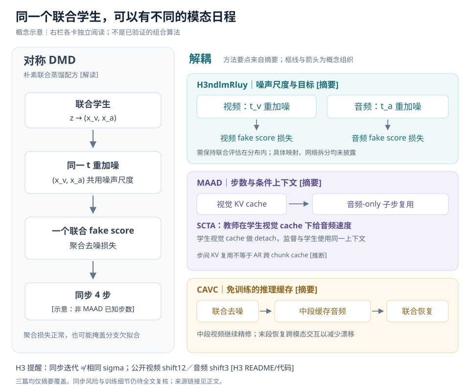

# 方向卡深读：音视频少步蒸馏要「打破模态对称」

> **来源与标注说明**：三篇均只读到摘要，覆盖等级为 **abstract-only**：[Modality-decoupled DMD](https://openreview.net/forum?id=H3ndlmRluy)、[MAAD](https://openreview.net/forum?id=GpT7BPei8K)、[CAVC](https://openreview.net/forum?id=eXi9xDxcDo)。OR PDF／附件返回 403，未绕过；arXiv、Semantic Scholar、OpenAlex、HF Papers、GitHub 均未找到孪生或代码，作者匿名。能拿到的只有摘要和 OR 元数据（keywords、TL;DR）。评级暂定，复核截止 **10-21**。
>
> **[摘要]**：作者在 OR 摘要中的陈述，未经复现。**[已核实]**：背景文献或公开代码已核对，不代表效果复现；H3 数字另标 **[H3 README/代码]**。**[我们推导]**：我们自己在玩具模型上的推导，或按公开代码配置做的算术。**[推断]**：摘要外机制、适用性判断；**[解读]** 也属推断。第七节的实验方案是我们的设计，不是论文结果。

> **更正今天日报方向卡的一处推断**：卡片里写「我们 H3 的 DMD 少步线音频、视频共用一个重加噪 t（推断）」。查公开代码后发现，公开 H3 推理本身就是视频 shift=12、音频 shift=3 两条 sigma 序列，见第七节。我们内部蒸馏实现是否沿用这个配对，仍需训练侧确认。

## 一、先说结论

- **是什么**：针对联合音视频生成，分别调整重加噪、fake-score 目标、去噪步数与缓存。共同反对的是机械共享配方，不是共享主干。[摘要／解读]
- **新在哪**：若全文成立，价值在于定位「聚合损失正常、某模态仍欠拟合」，解释相关结构为何更怕重加噪，以及利用音频漂移的可恢复性。不同模态用不同时间，本身已有前作。[摘要／推断]
- **证据缺口**：没有全文、消融或可核对的同步指标。MAAD 只测唱歌；CAVC 对 alignment 只称 competitive。基线配置与训练总成本都不清楚。[摘要]
- **评级**：维持 **值得看·暂定（新发现 × 证据不足）**，不升「必读」。全文或 OR 公开后重评，不能用单模态分数替代联合质量证据。
- **对 H3 最重要**：公开推理已用视频 **shift=12**、音频 **shift=3** [H3 README/代码]。同一次联合 forward，并不等于同一 sigma。蒸馏若强行同 sigma，反而偏离底座的推理配对；是否造成教师分布外评估，仍是 [推断]。见[调度配置][h3shift]。
- **先做什么**：先查内部配对，再做分模态诊断 E0 与配对重加噪 E2′，随后损失归一化 E1。看到问题后才扩到独立时间与音频子步；无需等全文才开始排查。[实验设计]

## 二、问题：对称配方是什么、为什么会出问题

输入是噪声 z 和条件，联合学生输出视频与音频 latent：`Gθ(z) → (x_v, x_a)`，再经各自 VAE 解码。下面是 [DMD][dmd] 的加权形式；real score 由冻结教师近似，fake score 在学生样本上学习。[已核实]

```text
x₀ = Gθ(z)
x_t = α_t·x₀ + σ_t·ε
u_real / u_fake = ∇x log p_real,t / ∇x log p_fake,t
−∇θL_DM = E[w_t·α_t·J_Gᵀ·(u_real − u_fake)]
J_G = ∂Gθ/∂θ
```

这里 real−fake 是**下降方向**，不是损失梯度。把生成器直接换成联合模型，容易继承以下配方；这是朴素移植，不是 DMD 的数学限制。[已核实／解读]

| 对称点 | 具体做法 | 可能漏掉什么 [推断] |
|---|---|---|
| 重加噪 | 两模态取同一 t／sigma | 数值相同，信号保留程度未必相同 |
| fake score | 联合网络，聚合去噪损失 | 大分支掩盖小分支欠拟合 |
| 更新日程 | 同网格、同步数、每次一起更新 | 两模态需要精修的阶段未必重合 |



图中右栏是不同工作的干预位置，不是已验证的组合算法；左栏的四步仅作少步示意。

| 差异 | 为什么共享配方可能失效 |
|---|---|
| 噪声语义／SNR | `SNR_m = α_t²·Var(x_m)/σ_t²`。latent 方差、归一化与调度共同决定 SNR；相同 SNR 也不保证结构保留相同。[已核实／推断] |
| 信息结构 | 均值等一阶信息与跨时相关的信息衰减不同。节奏、旋律、音素连续性依赖跨时关系；视频运动也依赖时间，不能把视频归为「只有一阶信息」。[我们推导／推断] |
| token 数与时间率 | 音频时间采样密，不代表总 token 多；视频还铺着空间网格。token 数也不等于感知重要性。[推断] |
| 跨模态耦合 | 不同噪声级、旧视觉 KV、跳过跨模态注意力，都会改变对方看到的条件。单模态改善仍可能伴随同步退化。[推断] |

**H3 的 token 账**：按公开 Diffusers 默认无参考生成路径，画布 **1344×768**、**24 fps**、**124 帧** [H3 README/代码]。实际分块得到视频 **37,296 token，约 7,219/s**；双声道沿序列拼接，音频 **414 token，约 80/s** [H3 README/代码；我们推导]。音频占两者合计约 **1.1%** [我们推导]，不含文本、参考条件及 padding。依据[长度计算][h3length]与[空间 patch][h3patch]；不是简单按名义时间压缩率估算。

这支持「音频子步可能便宜」，不能把 token 占比直接当加速比。音频 Q 少，仍需读取视觉 KV；注意力带宽与音频 FFN 都有成本。[推断]

还要把「共享网络」与「共享任务权重」拆开理解。即使主干完全共享，分模态统计仍能暴露不同噪声桶的误差；反过来，模型已有模态专属参数，也不保证聚合目标会平衡两边。这里首先要诊断的是监督如何分配，而不是立即扩出独立主干。[推断]

## 三、原理：为什么重加噪对音频更伤

MAAD 摘要称：在高斯扩散路径上，跨时相关的信息按信号占比的平方衰减，均值类信息只按一次方衰减；同 SNR 的教师诊断也显示音频损失更多结构。[摘要] 我们能独立核实的是以下数学模型，未复现作者的模型诊断。

取两个时间点的高斯变量，均值向量 μ、固定标准差 s、相关系数 c；噪声独立于数据且跨时独立。[我们推导]

```text
x₀ ∼ N(μ, s²R(c))，R(c) = [[1,c],[c,1]]，|c| < 1
x_t = a·x₀ + s_t·ε，ε ∼ N(0,I)
v = a²s² + s_t²
ρ = a²s²/v                         # 信号方差占比
x_t ∼ N(aμ, vR(ρc))                # 相关系数缩成 ρc

I_μμ = ρ/[s²(1−ρ²c²)] · [[1,−ρc],[−ρc,1]]
I_cc = ρ²(1+ρ²c²)/(1−ρ²c²)²
高噪声下：I_μμ ≈ (ρ/s²)·I，I_cc ≈ ρ²
```

独立噪声增加边际方差，却不贡献跨时协方差。因此，「两个时刻如何配合」比均值更快失去可辨认的证据。这里的一阶指均值，不能泛指所有局部统计；方差本身也是二阶统计。[我们推导]

**数值直觉**：用 RF 路径 `x_t=(1−t)·x₀+t·ε`，令 **s=1、c=0.3**。把 **t 从 0.8 降到 0.7**，ρ 从 **0.0588 升到 0.1552**；相关 Fisher 约增至 **7.00 倍**，均值分量信息约增至 **2.64 倍**。[我们推导，不是模型效果]

边界必须带着读：

- ρ 是**信号方差占比**。若指信号幅度，幂次会变；摘要未定义其符号，不能无条件对齐。[我们推导]
- 这是二维高斯玩具模型，不区分长短程，也不能证明真实音频普遍比视频脆弱。映射到节奏、旋律，是 [推断]。
- **Fisher ≠ DMD 梯度**。前者是参数 score 的平方期望；后者使用样本空间 score 差，还乘权重与学生 Jacobian。不能直接宣布 DMD 梯度按 ρ² 衰减。[我们推导]
- 若 fake-score 偏差在相关方向上没有同步减小，它可能淹没已经变弱的纠错信号。[推断] 这解释了排查方向，不给最优尺度。

此外，上例 t 越小越干净；H3 代码约定 **t_H3=1−sigma，t_H3=1 为干净** [H3 README/代码，见[调度器][h3sched]]。后文「音频降噪声」指减小 sigma，不是减小 H3 的 t。

## 四、三篇逐篇

### H3ndlmRluy：把噪声尺度与 fake 分支目标拆开

**做了什么**：[Modality-decoupled DMD](https://openreview.net/forum?id=H3ndlmRluy) 针对联合 fake-score 聚合损失看似正常、某模态仍欠拟合的问题，分别设置音视频噪声日程和分支训练目标。[摘要]

**解耦了什么**：明确解耦噪声尺度与目标。t 的采样分布、步数是否异步、cache 均未披露；不能把「分别选尺度」写成任意双时间联合调用已获支持。

**机制**：摘要原话要点是 “different renoising scales” 和 “retaining in-distribution joint model evaluations”；fake score 在各模态实际使用的尺度上训练分支目标。[摘要] 可能需要教师见过不同模态时间，或用映射／约束保持评估在分布内。[推断] 摘要未交代怎样实现，也没说一定是音频尺度更小。

**数字与基线**：在 **LTX-2.3、4 步**上，归一化完整 VBench **0.642→0.674**，CLAP **0.268→0.306**。[摘要] 基线名称、训练预算和归一化口径未给；CLAP 不能充当音画同步证据。

**训练成本**：未报告。分支目标不必意味着分离主干；是否新增 forward 或参数仍未知。[推断]

**缺什么**：尺度／目标的独立消融、噪声配对方法、fake 拟合曲线、同步指标、数据与基线细节。现在无法把增益归因到某一改动。

**如何读这个结果**：音视频分数同时改善，是值得追全文的信号；它尚未证明两项改动都必要，也没有排除基线拟合不足的影响。后续复核应优先查共同预算下的对照，以及改目标后究竟是哪一模态、哪个噪声区间的误差下降。[推断]

### MAAD：音频加子步，教师使用学生视觉上下文

**做了什么**：[Horses for Courses](https://openreview.net/forum?id=GpT7BPei8K) 提出 MAAD，在共享学生内解耦优化目标与步数日程；理论诊断指向音频跨时结构欠监督。[摘要]

**解耦了什么**：明确包括目标、音频-only 子步、视觉 KV 复用，以及 SCTA 的条件上下文。独立重加噪尺度及 t 采样的具体实现未披露。

**机制**：子步复用视觉 key/value；SCTA 在学生 **detach 的视觉 cache** 下直接评估教师音频 velocity，使监督目标与学生使用同一视觉上下文。[摘要] **[解读]** 这类似把 [Self Forcing][sf]「在自己的上下文上训练」从时间维搬到模态维；不是摘要声称的方法等价。

公开 H3 基础路径是双向全序列注意力，未见 AR 跨 chunk KV 复用。[已核实，见[注意力实现][h3attn]] 因而这里可能是视频步之间冻结视觉 K/V，不能直接理解为我们的流式历史 cache。[推断]

**数字与基线**：底座为 **MiniMax-H3 33B**；**9 项**唱歌指标胜过所比较方法，MuQ FAD **11.37→4.58**；**6 项**歌质分数中 **4 项**追平或超过 **50 步**教师。[摘要] 对照方法名称与该 FAD 起点身份未知；摘要也未给 MAAD 学生的具体总步数，不能补成已知结果。

**训练成本**：音频子步额外计算约 **+6%** [摘要]，不是训练总成本或端到端延迟报告。结合 H3 token 账，这个量级有可解释性，但仍需实测。[推断]

**缺什么**：只唱歌，未证实对对白、环境音、动作音泛化；没有同步指标、目标／子步／SCTA 消融、子步位置、总训练预算及缓存实现。

尤其要拆开「额外计算」与「额外监督」：子步增加修正机会，SCTA 改变教师给目标时的条件。若只比较整套方法，无法判断收益主要来自哪里。对我们而言，先做免训练子步探针，再决定是否投入上下文对齐训练，正是在分开检验这两个假设。[推断／实验设计]

### CAVC：中间省音频，末段恢复联合去噪

**做了什么**：[CAVC](https://openreview.net/forum?id=eXi9xDxcDo) 是免训练推理缓存。其观察是「可恢复性不对称」：中段缓存造成的音频漂移可被末段联合去噪修复，缓存视频造成的运动与时序细节损失则持续存在。[摘要]

**解耦了什么**：解耦推理计算与 cache；没有声称修改训练目标或独立 t 采样。

**机制**：三明治结构——前段联合去噪；检测到音频输出进入可缓存区间后，复用音频去噪输出，跳过音频去噪及跨模态注意力，视频继续精修；末段恢复联合计算以减少漂移。[摘要] 相邻输出变化可以是检测信号的候选，但不是已披露实现。[推断]

**数字与基线**：多个公开 benchmark 上墙钟加速 **1.10–1.35×**，若干视觉动态及时序统计改善；音质与 alignment 仅称 competitive。[摘要] 底座、硬件、计时边界及基线配置未知。

**训练成本**：无需训练 [摘要]；检测、缓存显存和工程接入成本未披露。

**缺什么**：触发准则、缓存区间与末段长度、恢复性消融、同步指标数值；尤其缺少在已经很少步时是否仍有缓存空间的证据。

## 五、前作与边界

以下背景事实已对照 arXiv 原文或公开代码 **[已核实]**；最后一列为本页 [解读]。

| 前作／实现 | 已经做了什么 | 对新意的边界 |
|---|---|---|
| [UniDiffuser][uni] | 图像、文本分别采样并输入 t | 独立模态时间不是新概念；不是 AV 少步蒸馏 |
| [Diffusion Forcing][df] | 逐 token 噪声级 | 不同去噪进度已有统一框架，不等于解决 AV fake-score 失配 |
| [LTX-2 trainer FlexibleStrategy][flex] | 支持逐模态采样 sigma；另有共享路径 | 代码支持不证明原始预训练覆盖任意配对 |
| [Ovi][ovi] | 训练共享 t，推理共享调度；已有模态加权损失 | 不能把共享时间等同于所有目标完全对称 |
| **[TurboT2VA][turbo]**（2608.24674） | LTX-2 上四步 AV 蒸馏，使用 per-modality normalization [已核实] | **最接近的公开前作**；损失层打破对称已有直接先例 |
| [DMD][dmd]／[DMD2][dmd2] | 分布匹配；改善 fake-score 更新与多步训练 | 给出 score 拟合问题的背景，未直接解决 AV 模态差异 |
| [Self Forcing][sf]／[CausVid][caus] | 自生成历史训练；双向教师监督因果学生、ODE 初始化 | 上下文匹配与师生因果性，不是同一种模态解耦 |
| [Presto!][presto]／[DMOSpeech][dmo] | 音乐／语音蒸馏，结合音频任务目标 | 音频专门监督已有先例，联合同步仍是额外约束 |
| [TeaCache][tea] | 依据跨步变化免训练复用计算 | CAVC 的候选新意是模态可恢复性与联合恢复策略 |
| [公开 H3 推理][h3shift] | 视频 shift12／音频 shift3 [H3 README/代码]，同步联合更新 | H3 早已调度不对称；蒸馏应先核对是否保持配对 |
| SGLang 里的第三方 H3 少步变体 | FastH3 8 步、VDN-H3 8 NFE（同样视频 shift12／音频 shift3）、`dmd_steps` 接口 [已核实：配置存在] | 说明 H3 少步已有人做；训练方法未公开，效果未核实 |

H3 是稠密单流主干，attention／FFN 共享，模态专属参数在输入、输出与 AdaLN。[已核实，见[README][h3arch]] 「分支损失」因此可以是输出切片上的目标分工，不能据此杜撰独立音频网络。[推断]

公开实现用时间值表和逐 token 索引选择调制参数，说明接口能表达不同模态时间；它不等于任意时间组合都训练过。[已核实／推断] 同样，公开的 AdaLN 调制缓存、VAE 分块解码，与去噪 Transformer 的视觉 KV 复用是不同对象，不能把其中一种支持当作另一种已可直接使用。[已核实]

## 六、综合：打破对称的六个位置

表中工作归属来自摘要或已核实背景；成本与风险未披露之处均为 [推断]。

| 位置 | 谁做了 | 成本 | 同步风险 |
|---|---|---|---|
| 重加噪尺度 | H3ndlmRluy；H3 已有推理配对 | 调度算术轻；额外评估未知 | 跨模态条件噪声级改变 |
| t 采样分布 | UniDiffuser、FlexibleStrategy；目标论文细节未知 | 越出支持范围可能需适配训练 | 教师与 fake score 可能分布外 |
| 损失／score | 分支目标、TurboT2VA 归一化；MAAD 目标分工 | 加权轻，具体新目标成本未知 | 单模态改善未必保联合关系 |
| 步数预算 | MAAD 音频-only 子步 | +6% 计算 [摘要] | 音频看旧视觉 KV |
| 推理缓存 | CAVC | 免训练；1.10–1.35× 加速 [摘要] | 中段缺跨模态更新，末段能否修回 |
| KV 与条件上下文 | MAAD 复用 KV、SCTA | 省视觉计算；教师监督成本未知 | 对齐了上下文，仍需验证同步 |

**可预测的是区别对待；值得追的是可检验的失效机制。** 分支欠拟合诊断、Fisher 解释、学生视觉条件下的对齐和音频可恢复性，才是待全文验证的新意。也不能把任意不同 t 都当成安全选择。[推断]

三篇有表面张力：CAVC 指向多步时音频「算力过剩」，MAAD 指向少步时音频「结构欠监督」。可能的调和是：粗结构或均值类线索较早确定，中段可缓存；弱跨时关系在重加噪后难以监督，少步时仍需低噪声精修。[推断] 因而多给还是少给音频计算，要看步数区间，不能统一成「音频越多步越好」。

仍有以下开放问题：

- H3 预训练的 t 是否逐模态独立采样，还是主要沿固定 shift 配对？推理接口不能证明训练覆盖。
- t_a≠t_v 时，教师与 fake score 是否都在分布内？保持底座配对和任意独立采样是不同实验。
- 子步、缓存能否降低 AR 每 chunk 延迟？吞吐改善是否被串行依赖抵消？
- 唱歌以外，对白、环境音、动作音能否受益？运动与声音事件的耦合强度不同。
- 同步指标是否可信？AVC-Reward（2610.22321）报告复杂场景 DeSync 与人评的 **SRCC 仅 0.061** [见 [10-19 日报 AVC-Reward 卡](https://thughy.github.io/video-wm-daily/daily/2026-10-19/)，RL 队友已用官方脚本复跑]。因此必须分单事件／复杂两档，复杂档加人评。
- 子步如何与 CFG-distilled 权重交互？公开 H3 权重已蒸馏 guidance，不能将其自动视为步数蒸馏；也不能假定额外子步仍沿用合适的监督轨迹。[已核实／推断，见[权重说明][h3cfg]]

## 七、对我们训练的含义（H3 VarLen）

**待训练侧确认**：

- 内部 DMD／ODE／CD 的重加噪与学生步，是否已经按模态 shift 配对？需要检查实际送进教师、fake score 与学生的 sigma，而非只看循环索引。
- 内部预训练 t 采样是否独立按模态？支持范围是否覆盖计划测试的配对？

公开 H3 的配对关系为：[H3 README/代码，见[调度器][h3sched]]

```text
sigma_m = shift_m·b / (1+(shift_m−1)·b)
t_H3,m = 1−sigma_m
```

取共同 **b=0.5**，视频 **shift=12 → sigma≈0.923**，音频 **shift=3 → sigma=0.75** [H3 README/代码；我们推导]。音频在同一网格位置已经更干净。由此猜测底座至少适应这条配对曲线，是 [推断]；不能声称已知预训练分布。若内部蒸馏改成同 sigma，教师可能偏离熟悉配对，正对应摘要强调的分布内评估问题。[推断]

**统一指标面板**：音频 FAD／MuQ、CLAP；视频 VBench，关注时序项；同步 Sync-C／LSE、DeSync 单事件／复杂两档；复杂档加小规模人评；同时报算力、端到端延迟与 AR 每 chunk 延迟。各实验都用该面板，下表只列额外重点。[实验设计]

读指标时分别回答：声音是否自然、是否符合条件、视频是否稳定、声画事件是否对得上。某项指标变好不能代替另一项。复杂场景人评尤其要检查声音来源与事件对应，而非只听音质；没有明确对应关系的样本，也不宜强行用口型同步指标下结论。[推断／评估建议]

| 实验 | 做法 | 改动量／算力 | 阶段 | 看什么／成功判据 |
|---|---|---|---|---|
| **E0 诊断** | 按模态 × t 分桶记 fake-score 去噪损失与 DMD 梯度范数；同 SNR 做教师重加噪—去噪诊断 | 训练目标不变；日志轻，教师诊断另计评估开销 | 双向与 AR 的现有 DMD；ODE／CD 可查重建结构 | onset／chroma 自相关、MuQ FAD 对照 VBench 时序项；能否稳定复现「聚合正常、音频欠拟合」 |
| **E2′ 配对** | 同一 b 分别按底座 shift12／shift3 重加噪，对照同一 sigma [H3 README/代码] | 小改调度；不增加模型调用 | 双向 DMD 先做；核对 ODE／CD 配对，再到 AR | 音频结构与 fake 拟合改善，视频和同步不退化；这是检验配对假设 |
| **E1 损失** | fake-score 分支损失分别归一化／加权；同 checkpoint、同步数对照共享目标 | 小改损失；几乎无额外算力 | 双向 DMD，验证后 AR | 音频桶不再被聚合损失掩盖，联合面板改善 |
| **E2 噪声** | 比较共享 t、音频独立且偏低噪声、等 SNR 映射；H3 下用 sigma 描述方向 | 采样改动小；若需适配教师／fake，训练成本另计 | 先双向，再 AR；CD 为后续迁移 | 在教师／fake 支持范围内，音频结构收益可重复，同步不退化 |
| **E3 子步** | 在现有 **4 步**学生每个视频步后插 **1 个**音频-only 子步，复用视觉 KV；有效再训 SCTA [实验设计，非论文步数] | 先免训练探针；需实现缓存，训练 SCTA 更贵 | 双向推理探针→训练→AR 流式 | 音质增益配得上实测开销，且每 chunk 延迟和同步可接受 |

E2 的前提是教师和 fake score 在异时间组合下可用。若预训练未覆盖，先做短期 UniDiffuser 式独立 t 适配，或限制为小偏移；小偏移也需诊断，不能自动视为分布内。[实验设计／推断]

CD 的一致性目标也可按模态取 t，是后续 [推断]，需定义配对轨迹与目标关系，不能只替换采样器。多步教师／数据合成侧可另试 CAVC 式中段音频缓存；不与少步学生的子步收益混算。[实验设计]

**推荐顺序：训练侧核对 → E0 与 E2′ → E1 → E2 → E3。** E0 是无目标改动的诊断，教师探针仍有评估成本；E2′ 是最便宜的配方对照。若内部已经正确配对，直接记录并跳过重复实验。若 E0 看不到音频欠拟合，E2／E3 降优先级。VarLen 下按时长与 chunk 条件分层看结果，避免平均数掩盖长程或边界问题。[实验设计／推断]

## 八、一句话带走

**对 H3，先别把已经不对称的底座蒸馏成同一 sigma；先保住噪声配对，再用分模态诊断决定音频该换目标、加子步，还是省计算。**

[dmd]: https://arxiv.org/abs/2311.18828
[dmd2]: https://arxiv.org/abs/2405.14867
[sf]: https://arxiv.org/abs/2506.08009
[caus]: https://arxiv.org/abs/2412.07772
[uni]: https://arxiv.org/abs/2303.06555
[df]: https://arxiv.org/abs/2407.01392
[ovi]: https://arxiv.org/abs/2510.01284
[turbo]: https://arxiv.org/abs/2608.24674
[presto]: https://arxiv.org/abs/2410.05167
[dmo]: https://arxiv.org/abs/2410.11097
[tea]: https://arxiv.org/abs/2411.19108
[flex]: https://github.com/Lightricks/LTX-2/blob/e98f6d927d83c92ef2be6aec76c8440b19306e39/packages/ltx-trainer/src/ltx_trainer/training_strategies/flexible.py#L260-L278
[h3shift]: https://github.com/MiniMax-AI/MiniMax-H3/blob/d21241f0a4b3acbb34c97dae47fa417b7065e438/FL2VA/model_index.json#L29-L40
[h3sched]: https://github.com/huggingface/diffusers/blob/b800f828f3951c4d206e154411bcbfa693cd322e/src/diffusers/schedulers/scheduling_minimax_h3.py#L155-L168
[h3length]: https://github.com/huggingface/diffusers/blob/b800f828f3951c4d206e154411bcbfa693cd322e/src/diffusers/modular_pipelines/minimax_h3/modular_pipeline.py#L97-L147
[h3patch]: https://github.com/huggingface/diffusers/blob/b800f828f3951c4d206e154411bcbfa693cd322e/src/diffusers/modular_pipelines/minimax_h3/before_denoise.py#L308-L314
[h3attn]: https://github.com/huggingface/diffusers/blob/b800f828f3951c4d206e154411bcbfa693cd322e/src/diffusers/models/transformers/transformer_minimax_h3.py#L168-L205
[h3arch]: https://github.com/MiniMax-AI/MiniMax-H3/blob/d21241f0a4b3acbb34c97dae47fa417b7065e438/README.md#L150-L158
[h3cfg]: https://github.com/MiniMax-AI/MiniMax-H3/blob/d21241f0a4b3acbb34c97dae47fa417b7065e438/README.md#L184-L191
