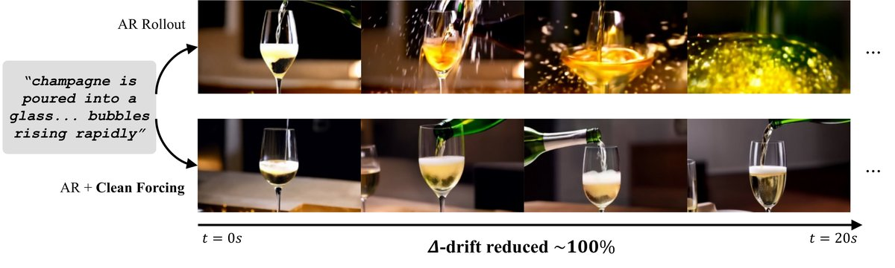
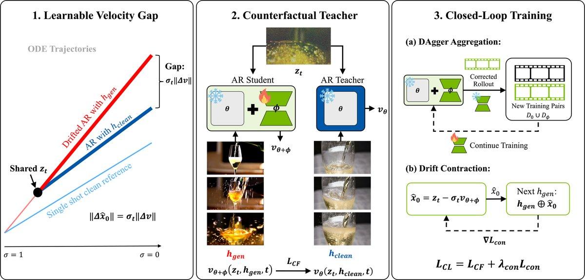
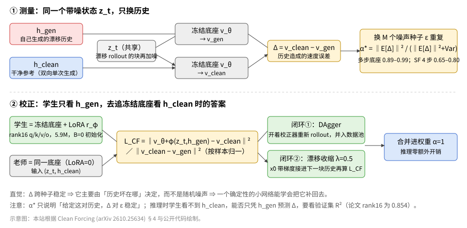
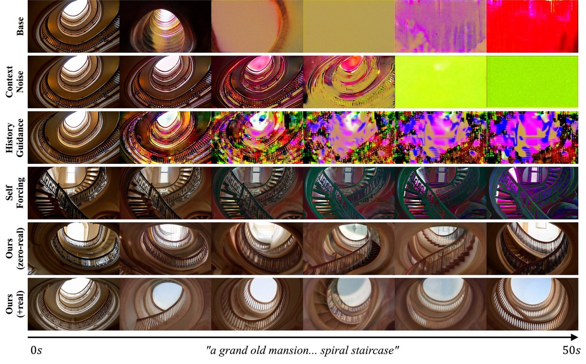

# 深读：Clean Forcing——AR 视频漂移是「可学的系统误差」

> **来源**：[Clean Forcing: Drift-Resistant Autoregressive Video Diffusion with a Frozen Base][paper]（arXiv 2610.25634 v1，2026-10-19；Wenqing Wang、Joonghyuk Shin、Jonathan Tremblay、Chan Hee Song、Yun Fu；Northeastern / SNU / NVIDIA；ICLR 2027 投稿 [OR 6cVOrqYuGm][or]）。[代码][code]（Apache-2.0）、[权重][w]、[评测视频与逐条测量][res]均已公开。**覆盖**：全文与附录 A–L 通读；代码读了损失、配对构造、α* 估计和 Self Forcing 移植脚本；**没有 GPU 复跑**。
>
> **标注**：**[论文]** 作者陈述或表格数字；**[代码]** 在公开仓库核对过；**[推断]** 我们的判断，未经实验；**[实验设计]** 第七节的方案是我们提的，不是论文结果。文中图片除示意图外均来自论文/仓库，版权归原作者。

> **更正今天日报卡片一处**：卡片「要小心」里写了「全是自动指标，没有人评」。全文其实有用户研究（附录 J：33 名评审、858 次判断），见第四节。卡片已同步改正。

## 一、先说结论

- **一句话**：自回归（AR）视频扩散越生成越烂，主要原因不是「随机误差累积」，而是**历史被污染后，模型的去噪速度出现了一个稳定、可预测的偏差**。作者把这个偏差量出来，再用一个 5.9M 参数的 LoRA 学着把它补回去。[论文]
- **核心测量**：固定带噪状态 z_t，只把历史从「自己生成的」换成「干净的」，同一个冻结模型的速度差 Δ 跨噪声种子约 **95%** 可复现（三个多步底座 α* ∈ [0.89, 0.99]）。[论文；估计器见代码]
- **核心结果**：50 秒、128 条 MovieGen 提示，Δ-drift 从 **+11.27** 降到 **+1.65**（零真实视频）/ **−0.16**（加 40 段真实视频）；Self Forcing 同协议 **+1.08**。零真实版是**追平而不是超过** Self Forcing。合并后推理零额外开销，训练约一张 GB300 一天。[论文]
- **反例最重要**：把同一套方法套到 4 步蒸馏的 Self Forcing 上，MUSIQ 69.3→47.5、Δ +1.08→+8.3，**越修越坏**；事前诊断 α* 只有 0.65–0.80，速度差小约 10 倍。[论文]
- **评级**：**必读（新发现 × 站得住，限多步底座）**。值得读的是「测量方法 + α* 事前门槛」，不是「拿来直接接到我们的少步学生上」。与少步同事的「值得读·流式」有分歧，理由见第六节。
- **对 H3 最直接**：H3 同时有 AR 和双向阶段，正好具备论文「零真实视频」所需的干净参考来源。先花几千次前向，在我们的 AR 多步检查点和 DMD 少步学生上**分别**、**分模态**测 α* 与相对误差大小，再决定要不要训校正器。[实验设计]

## 二、问题：为什么 AR 视频会越生越烂

### 2.1 AR 视频扩散在做什么

视频切成 K 个 latent 块，每块 f 帧；第 k 块在「已提交的历史 h⁽ᵏ⁾ = x⁽<ᵏ⁾」和文本 c 条件下，用流匹配去噪生成：[论文 Eq.1]

```text
p_θ(x | c) = ∏_k p_θ(x⁽ᵏ⁾ | h⁽ᵏ⁾, c)
z_t = (1 − σ_t)·x₀ + σ_t·ε             # 流匹配加噪
L_FM = E‖v_θ(z_t, h, t) − (ε − x₀)‖²     # 训练目标：预测速度
推理：每块从纯噪声出发，沿 dz/dσ = v_θ 积分 T 步（本文 T=20），生成完就「提交」进历史
```

### 2.2 曝光偏差（exposure bias）

**训练时**，历史 h 是干净的真视频（teacher forcing）；**推理时**，历史是模型自己刚生成的、带瑕疵的块。于是条件分布不一致：`p_θ(x⁽ᵏ⁾ | h_gen) ≠ p_θ(x⁽ᵏ⁾ | h_clean)`。每块的小误差进入下一块的历史，误差随块数复合（论文引 DAgger 的结论：O(K²ε)）。表现是几秒到十几秒内过饱和、纹理消失、场景崩掉（见下图上排）。[论文]



*图源：Clean Forcing 论文 Fig.1 / 仓库 assets/teaser.jpg。前 20 s：上排香槟杯逐渐过饱和直至消失；下排保持场景。*

### 2.3 已有的几类修法和各自代价

| 路线 | 代表 | 做法 | 代价 / 局限 |
|---|---|---|---|
| 训练时给历史加噪 | [Diffusion Forcing][df]、MAGI-1、SkyReels-V2 | 每帧独立噪声级，历史带噪训练；推理时历史也可加一点噪 | 把漂移当「均匀噪声」处理；本文同底座上推理时加噪 σ=0.2 反而 +12.05（基线 +11.27）[论文] |
| 历史引导 | [DFoT / History Guidance][dfot] | 推理时对历史做类 CFG 的引导 | 训练免费，但 NFE 翻倍；本文复现 +20.55 [论文] |
| 在自己的 rollout 上重训 | [Self Forcing][sf]、Self-Forcing++、BAgger、LongLive、[Rolling Forcing][rf] | 训练时就自回归 rollout，用 DMD 等分布级目标或反向聚合 | 有效但贵：要改整个生成器；BAgger 用 136K 段、16×H100；Self Forcing 类方法要 14B 双向教师 + 1.3B fake critic [论文 §1、附录 B] |
| 蒸馏成少步因果学生 | [CausVid][causvid]、Causal Forcing | 双向教师蒸馏到少步 AR 学生 | 同上，需完整蒸馏流程 |
| 推理时修正 / 缓存管理 | Pathwise TTC、TetherCache、Deep Forcing | 改采样路径、激活或 KV 缓存 | 免训练，但本文同底座 50 s 测试里都没降漂移（TTC +13.96 / +14.51）[论文] |
| 冻结底座 + 小校正器 | AutoRefiner、ERTACache | 学一个轻量修正 | 修的是采样噪声 / 缓存近似误差，**不是历史造成的误差** [论文 §2] |

论文的定位：在「冻结底座 + 小校正器」这一格里，第一次**直接**瞄准「历史造成的误差」。

## 三、核心发现：漂移是一个系统性的速度误差

### 3.1 反事实测量：同一 z_t，只换历史

对漂移 rollout 里的某个块 x₀（来自模型自己的 rollout），加噪得到 z_t；然后让**同一个冻结模型**跑两次，只换历史：[论文 §4.1]

```text
Δ(z_t, t) = v_θ(z_t, h_clean, t) − v_θ(z_t, h_gen, t)
```

- 两次输入的带噪状态完全相同，所以 Δ 只来自「历史不同」。这是一个干净的**反事实**：如果历史是干净的，模型此刻本该往哪走。
- 速度差换算成对干净 latent 的一步预测差：`‖Δx̂₀‖ = σ_t·‖Δv‖`。高噪声步的同样速度误差，对最终画面的影响更大。[论文 §4.2]
- `h_clean` 怎么来：与 `h_gen` 按 latent 位置对齐。漂移 rollout 从参考片段的前 3 个 latent 和字幕出发；对第 k 块，`h_gen` 是 rollout 里前 9 个 latent，`h_clean` 是参考片段里同位置的前 9 个 latent。[论文附录 A；代码 wan_build_pairs_*.py]

### 3.2 α*：多少比例是「系统的」

对每个 (片段, 位置 k, 时间步 t)，换 M 个噪声种子 s 重复上面的测量，得到 Δ_s：[论文 Eq.3]

```text
α*(t) = ‖E_s[Δ_s]‖² / ( ‖E_s[Δ_s]‖² + Var_s(Δ_s) ),   Var_s(Δ_s) = E_s‖Δ_s − E_s[Δ_s]‖²
```

- 代码里 M=4，并用了有限样本修正：`α̂ = max(0, ‖b̂‖² − var/M) / ‖b̂‖²`，所以小 M 造成的高估已被扣掉。[代码 wan_gate_estimate.py]
- 结果：三个多步底座（自适应的 Wan2.1-1.3B、Wan2.1-14B、Causal-Forcing 底座）在所有噪声级上 α* 都在 0.89–0.99，汇总约 0.95；14B 汇总 0.934。[论文 Fig.7、附录 G.1]

**直觉**：如果漂移是随机的，换个种子 Δ 就会变方向，平均下来接近零，α* 会很低；实测 α*≈0.95，说明 Δ 主要由「历史坏在哪里」决定，跟这一步抽到的噪声几乎无关。一个确定性的函数原则上能学会它，这就是方法成立的前提。

**这个指标没证明什么**[推断]：α* 只说明「给定这对历史，Δ 对噪声种子稳定」。推理时校正器看不到 `h_clean`，它必须只凭 `(z_t, h_gen)` 猜出 Δ。这一点 α* 不能保证，要看验证集 R²：rank-16 LoRA 的一步验证 R² 是 0.854。[论文表 9] 所以真正的证据链是「α* 高 + R² 高 + rollout 变好」三者一起，而不是 α* 单独。



*图源：Clean Forcing 论文 Fig.2 / 仓库 assets/pipeline.png（透明底已铺白）。*

## 四、方法：冻结底座 + 5.9M LoRA 回归这个差

### 4.1 我们画的示意图



### 4.2 第一阶段：一步反事实老师（Eq.4）

```text
L_CF = E_{k,t,ε} [ ‖v_{θ+LoRA}(z_t, h_gen, t) − v_θ(z_t, h_clean, t)‖² / ‖v_θ(z_t, h_clean, t) − v_θ(z_t, h_gen, t)‖² ]
R² = 1 − L_CF       # 每个样本的漂移缺口被补上了多少
```

- **学生**：冻结底座 + LoRA，看 `h_gen`。**老师**：同一个网络、LoRA 缩放为 0，看 `h_clean`。没有外部教师。[论文；代码 wan_train_v2.py 第 107 行]
- **分母**：用该样本的原始缺口归一化，防止大缺口样本主导；分母不带梯度，加 1e-8。[论文附录 A；代码]
- **z_t 必须来自漂移 rollout 自己的块**。若改用真视频轨迹上的 z_t（GT-anchored），历史和状态来自不同场景，学到的是错配修正，漂移反而变大。[论文 §4.2、表 2]
- **LoRA**：rank 16，挂在全部 30 个 DiT block 的自注意力 q/k/v/o 上，5.9M 参数（底座的 0.4%）；B 矩阵零初始化，起点与底座完全一致。lr 5e-4，800 步，batch 1。[论文 §5、表 3]

### 4.3 第二阶段：闭环（DAgger + 漂移收缩）

一步训练只见过「未校正模型」走到的状态，部署时却走在「校正后模型」的状态上，这就是 DAgger 要解决的协变量偏移。[论文 §4.3]

- **DAgger 聚合**：打开校正器重新 rollout，生成新配对，与第一轮数据池均匀混合继续训。
- **漂移收缩**：用校正后的速度估计 `x̂₀ = z_t − σ_t·v_{θ+LoRA}`，**不切断梯度**地接到下一块的历史里，再在下一块上算归一化的 L_CF：`L_con = L_CF(x₀⁺; h_gen ⊕ x̂₀, h_clean ⊕ x̄₀)`。总损失 `L_CL = L_CF + 0.5·L_con`。lr 2e-4，600 步。[论文 Eq.5–6；代码 wan_train_v2.py 第 125、142 行]
- 含义：不仅要求「这一步说对」，还要求「这一步提交的结果别把下一步带偏」。

### 4.4 干净历史从哪来：零真实视频

- 核实少步同事的说法：**对，但要更精确**。干净参考是**同一个 Wan2.1-1.3B 检查点**用**双向全注意力单次生成**的 300 段 5 s 片段（30 步、默认引导、每段固定种子，MovieGen 提示与评测集不重叠）。不是 14B 教师。[论文附录 A；代码 wan_build_pairs_sf.py 注释]
- 道理：双向单次生成没有 AR 回灌，所以没漂移；同一个模型能生成干净片段，说明漂移来自 AR rollout 而不是模型容量不够。[论文 §4.1]
- 注意前置步骤：双向检查点只能「续写」不能从纯提示开始做 AR，所以作者先用**同一批 300 段合成片段**做了一个 rank-64 的因果适配（Diffusion Forcing 目标，4K 步），合并进权重，这个才是表里的「Adapted base」。[论文 §4.4、附录 A]
- 可选的 40 段真实片段只用来当干净参考。论文测了 16 / 40 / 300 段三档，漂移变化不大。[论文附录 I]

### 4.5 成本

| 项目 | 数值 | 来源 |
|---|---|---|
| 训练数据 | 最多 340 段（40 真 + 300 合成）；零真实版只用 300 合成 | [论文 §5] |
| 训练算力 | 含生成老师片段在内约 1 张 GB300 一天，bf16，≥48 GB 显存；14B 约 3 GPU-day；Causal-Forcing 底座一次 36 h | [论文 §5、附录 G] |
| 推理（合并 α=1） | 2.90→3.00 s/chunk（+3.5%，Welch p=0.40，不显著），显存 29.49 GiB 不变，ΔNFE=0 | [论文表 5] |
| 推理（不合并） | 3.92 s/chunk，+35% | [论文表 5] |
| α<1 或按 t 变强度 | 需要为每个强度存一套合并权重；Eq.2 的输出混合与「缩放 LoRA 再合并」在 0<α<1 时不等价 | [论文附录 E] |

## 五、结果：数字与案例

### 5.1 主表（50 s，128 条留出 MovieGen 提示，±为 SEM）[论文表 1]

| 方法 | Subj. | Aesth. | Imag. | Dynamic | MUSIQ | Δ-drift↓ |
|---|---|---|---|---|---|---|
| Adapted base | 65.7 | 44.9 | 47.9 | 29.7 | 44.8 | +11.27±0.81 |
| + 上下文加噪 σ=0.2 | 67.2 | 45.2 | 51.4 | 32.0 | 49.1 | +12.05±0.76 |
| + 历史引导 w=1.2 | 64.6 | 42.4 | 47.7 | 0.8 | 42.3 | +20.55±0.65 |
| **+ Clean Forcing（零真实）** | 81.0 | 60.5 | 63.9 | 48.4 | 66.9 | **+1.65±0.35** |
| **+ Clean Forcing（+40 真实）** | 80.9 | 61.4 | 64.1 | 49.2 | 67.0 | **−0.16±0.12** |
| Causal-Forcing 底座 | 64.9 | 45.8 | 56.1 | 33.6 | 52.0 | +11.99±0.67 |
| + Clean Forcing（零真实） | 81.8 | 62.9 | 62.0 | 70.3 | 62.1 | +2.80±0.42 |
| Self Forcing（已发布） | 80.2 | 60.9 | 67.7 | 39.8 | 69.3 | +1.08±0.39 |
| SkyReels-V2-DF（已发布） | 87.0 | 61.0 | 62.8 | 50.8 | 61.5 | +1.00±0.30 |
| BAgger R3†（不同提示，仅参考） | 84.1 | 55.4 | 63.4 | 76.6 | — | +3.57 |

- **Δ-drift 定义**：前 20% 帧的 MUSIQ 减全片 MUSIQ，越小越好。它在长时长会饱和（崩掉的尾巴拉低全片均值），必须和绝对 MUSIQ 一起看。[论文附录 I]
- **怎么读**：零真实版 +1.65 与 Self Forcing +1.08 相差 0.57，合并 SEM 约 0.52，**统计上打平，不是赢**；绝对画质 MUSIQ 66.9 仍低于 Self Forcing 69.3。+40 真实版 −0.16 是表里漂移最低的。[论文；SEM 合并为我们计算]
- 论文说「超过最好的已发表结果 +3.57」，但 BAgger 用的是不同底座和提示集，只能当参考。[论文自述]

### 5.2 其他指标与消融

- **时长扫描**[论文表 14]：零真实版 10/30/50 s 的 Δ 为 +1.25/+1.30/+1.65，有轻微逐步下降；+真实版 +0.39/−0.01/−0.16 基本平。
- **14B**：50 s Δ +15.65→+0.97（降 94%），MUSIQ 46.4→69.0，dynamic degree 保持 37.5；但闭环阶段验证 R² 从峰值 0.643 跌到 0.415，**选检查点影响大**。[论文附录 G.1]
- **其他 AR 世界模型**：HY-WorldPlay 和 OmniDreams 上 α* 随噪声级明显变化（HY-WorldPlay 0.81→0.53），作者只用 0.5α* / 0.25α* 的弱校正，Δ 分别降 48% / 60%，OmniDreams 运动量少了 17%。[论文附录 G.3]
- **组件消融**（约 12 s 续写）[论文表 2]：一步校正去掉 66% 漂移 → +DAgger 70% → +收缩 73%，后段 MUSIQ 36.9→60.5；全规模固定数据下闭环把 Δ 从 +4.77 降到 +1.65。
- **目标消融**：无干净参考的 DMD 目标去掉 0% 漂移；直接拟合真值（factual）会让运动塌掉；GT-anchored 让漂移变大。说明「同一 z_t 的反事实」是关键。[论文表 2]
- **容量消融**：全参微调 283M 只降 23%，旁路网络 1.9M 降 25%，rank-16 LoRA 降 73%；rank 8–64 验证 R² 几乎一样（0.829–0.854），但 rank 32/64 的 rollout 画质更差。**一步拟合好不等于 rollout 好**。[论文表 9]
- **底座训得更久不能替代校正**：因果适配 4K→20K 步，底座 MUSIQ 提升但漂移仍大；在 20K 底座上重训校正器只到 62.3，不如 4K 底座 + 校正器的 66.9。校正器要贴着具体检查点的误差来学。[论文附录 E]
- **迁移**：校正器权重搬到兄弟检查点只保留约 25% 的漂移校准；从多步模型搬到 4 步蒸馏模型，R² 只有 +0.03。配方可迁移，权重不行。[论文附录 E]
- **用户研究**[论文附录 J、表 16]：33 名评审、858 次判断，只看 40–50 s 的 10 s 片段，**只测了 +40 真实版**。总体偏好：对 Adapted base 93.0%，对 Self Forcing **83.9%**，对 SkyReels-V2 42.7%（p=0.09，不显著）。时间稳定性：对 Self Forcing 46.9%（**不显著**），对 SkyReels-V2 只有 21.0%（SkyReels 是 24 fps，其余是 16 fps）。

### 5.3 代价：它不是全面胜利

| 指标 | Adapted base | 零真实 | +真实 | Self Forcing | SkyReels | 来源 |
|---|---|---|---|---|---|---|
| Anchoring（末 1/5 与开头的 DINO 相似度，越高越「原地不动」） | 0.336 | 0.679 | 0.795 | 0.485 | 0.697 | 表 15 |
| 2 s 滞后身份一致性↑ | 0.812 | 0.830 | **0.746** | 0.922 | 0.927 | 表 15 |
| 镜头切换 / 视频↓ | 2.82 | 0.89 | 0.04 | 0.26 | 0.12 | 表 15 |
| 时间 LPIPS↓ | 0.23 | 0.33 | **0.59** | 0.15 | — | 表 11 |
| Flicker↓ | 15.9 | 22.8 | **32.8** | 9.5 | — | 表 11 |

- **漂移降低和场景推进是一对权衡**：越抑制漂移，视频越停留在开头。收缩权重 λ 沿这条边界移动，但改不了边界本身。作者猜原因是干净参考多是变化很少的 5 s 片段。[论文附录 D]
- 作者的反驳：每个配置中「anchoring 较低的一半视频」上 Δ 仍为 +2.2（零真实）/ −0.1（+真实），全体视频 anchoring 与漂移的相关只有 −0.05。所以漂移降低不只是「不动了」。[论文附录 D]
- **块边界亮度脉冲**仍在：校正后背景不再糊，脉冲反而更显眼；时间 LPIPS 与 flicker 是全表最差。重叠解码可以部分缓解，但解码 NFE 增加三分之一。[论文附录 G.2、L]

### 5.4 案例：旋转楼梯（p098）



*图源：Clean Forcing 论文 Fig.4 / 仓库 assets/comparison_frames_p098.jpg，提示「a grand old mansion... spiral staircase」，各行种子相同。*

- 底座 15 s 后过饱和、最后变成大块纯色；上下文加噪同样烧成色块；历史引导变成碎片化的伪影。[论文 Fig.4 说明]
- Self Forcing 结构保住了，但后段整体偏青/紫，这就是论文说的「晚期色偏」。
- 两个 Clean Forcing 版本结构和颜色都保住了。但仔细看，零真实版中段楼梯的视角和构图几次明显变化，接近「换镜头」；+真实版则越来越接近一个固定的天窗仰视。这对应 5.3 节的切镜（0.89 次/视频）和 anchoring（0.795）。[推断：基于图像观察]

## 六、为什么在 4 步 Self Forcing 上失败

### 6.1 事实

- 作者对 Self Forcing 的 4 步蒸馏生成器做了完整移植：在它的 4 个蒸馏时间步上用 **x₀ 空间**的反事实损失（不是速度空间）。一步目标能学（R²=0.48），但部署后 MUSIQ 69.3→47.5、Δ +1.08→+8.3；DAgger 救不回来。[论文附录 E]
- 训练前的诊断就预示了：α* 只有 0.65–0.80，速度差本身约小 10 倍。作者给的经验法则是「预期收益 ≈ 缺口大小 × α*」。[论文附录 E、Fig.7]
- 作者自己承认：**这些实验没有隔离出机制**，只是「与大规模蒸馏已消掉了大部分系统缺口这一可能性相符」。[论文附录 E 原话大意]

### 6.2 核对少步同事的三条保留意见

| 同事说法 | 核对结果 |
|---|---|
| 移植只做了一次，超参照搬没扫 | **基本属实**[代码 wan_train_sf.py]：rank 16、lr 5e-4、warmup 60 与主线一致，步数默认 1500（主线 800）；论文没有报告任何 SF 移植的超参或强度扫描。特别是：对 α* 偏低、随 t 变化的 HY-WorldPlay / OmniDreams，作者用了 0.5α* / 0.25α* 的弱校正并且有效；**对 α* 同样偏低的 SF，却只试了满强度**。这是一个没测的旋钮。 |
| 机制没有隔离 | **属实**，作者原文就这么写。 |
| 零真实 +1.65 在同一 50 s 协议下仍差于 SF +1.08 | **数值属实**，但差距在约 1 个合并 SEM 内，论文称「打平」。SF 的绝对 MUSIQ、身份一致性、flicker 都更好；用户研究在时间稳定性上与 SF 不显著。所以「零真实视频追平完整蒸馏」成立，「超过」不成立。 |

### 6.3 我们的判断：为什么会失败 [推断]

1. **「干净参考」对 SF 来说未必更干净**（最主要）。代码显示 SF 移植用的 `h_clean` 仍是**那 300 段 Wan2.1-1.3B 双向单次生成片段**[代码 wan_build_pairs_sf.py]。SF 学生是用 14B 教师 + DMD 蒸馏出来的，自身 MUSIQ 69.3，可能比这批参考还锐利。于是 Δ 衡量的很可能不是「漂移」，而是「SF 自己的分布 vs 1.3B 底座的分布」之差，这也解释了为什么缺口小、α* 低。把学生往 1.3B 的风格上拉，画质自然下降。
2. **少步提交把拟合误差放大**。`‖Δx̂₀‖ = σ_t‖Δv‖`，4 步模型每步跨度大，每一步的预测几乎直接被提交进历史。R²=0.48 意味着残差约是缺口范数的 72%（√0.52）；当缺口本身小、且 20–35% 是随机的时候，校正器引入的误差与它能修的信号同量级，闭环里还会复合。
3. **DMD 学生处在一个尖锐的模式上**。DMD 是模式寻求的，输出分布窄；一个在别处学到的 LoRA 扰动容易把它推离模式，退化幅度（MUSIQ −21.8）远大于「残差 72%」本身能解释的量，更像是闭环失稳而不是单步不准。
4. **可验证的预测**：如果第 1 条是主因，那么用 **SF 自己的双向/长窗口单次生成**当 `h_clean`，或换成真实片段，α* 应明显上升；如果第 2 条是主因，换参考也不会救，但 0.25–0.5 的弱校正应至少不伤。这正是我们在 H3 上能便宜做的对照（第七节 E3）。

## 七、前作与反事实：新在哪、哪些可预测

### 7.1 最接近的几项工作

| 工作 | 训练时上下文 | 监督信号 | 更新谁 | 与 Clean Forcing 的差别 |
|---|---|---|---|---|
| [Self Forcing][sf] | 自生成 rollout | DMD：14B 双向教师 real score − fake score | 整个生成器 | 分布级目标，不分离「历史造成的误差」 |
| BAgger | 反向 rollout 聚合 | 真值 | 重训底座 | 数据量大（55K 源片段 + 81K 轨迹）|
| [DFoT 历史引导][dfot] | — | 推理时用「有/无历史」的速度差做引导 | 不训练 | 结构最像：也是「换历史看速度差」，但只在推理时外推，且同底座上更差 |
| AutoRefiner / ERTACache | — | 采样噪声 / 缓存近似误差 | 小校正器 | 修的误差来源不同 |
| OPSD-V（Liu 2026，同期）| 自生成 | 真实视频上的匹配状态目标 | 少步生成器 | 同期最近邻：也做「同状态」目标，但用真实视频、更新生成器 |
| DAgger（Ross 2011）| 学习者自己的状态 | 专家在这些状态上的动作 | 策略 | 闭环阶段直接借用 |

### 7.2 反事实：如果没有这篇论文，我们能预测多少

- **可预测的**：把「看干净历史时模型会怎么做」当成老师，属于模仿学习里「特权老师」的老思路；DFoT 已经在用「换历史的速度差」；DAgger 解协变量偏移是教科书做法。所以方法的骨架**能想到**。
- **预测不到的**：
  1. 这个差**约 95% 是系统的**，并且在 1.3B、14B 和独立训练的 Causal-Forcing 底座上都成立；
  2. **300 段自己生成的片段、5.9M 参数**就能把一个重度漂移的底座拉到与完整 DMD 蒸馏打平；
  3. 容量更大反而更差（全参 23% vs LoRA 73%）；
  4. 在少步蒸馏模型上**有害**，而且事前的 α* 能预示这一点。
- **原创性**：新发现 + 新机制（测量 → 门槛 → 校正），属于「把一个模糊的直觉变成可测量、可决策的量」。
- **可信度**：站得住，限多步底座。同底座公平对照、独立底座复现、14B 复现、有用户研究、代码与公式一致、负结果主动报告并公开了有害权重。扣分项：Adapted base 是只适配 4K 步的弱底座，漂移余量大；主指标 MUSIQ/Δ-drift 是自动指标；用户研究只测 +真实版；14B 选点敏感；场景推进与块边界脉冲问题。

### 7.3 评级与分歧

- **我的结论：维持必读**。理由是本站「必读 = 原创且站得住」两条都满足：α* 测量是可复用的新知识，证据链（同底座、跨底座、跨规模、人评、负结果）比同周的大多数流式论文扎实。
- **与少步同事「值得读·流式」的分歧**：同事的出发点是「对少步蒸馏侧，方法本身在 4 步学生上是负结果，属于发现型」，这个判断对**方法可用性**是对的。但我们的评级先看原创性：测量本身新，而且负结果恰好给了一个**事前判断能不能修**的工具（α* × 缺口），这对我们决定 AR 线要不要上校正器很直接。所以我把它定为「必读（读诊断，不是直接跑方法）」，不改成「必读·先跑」。
- **什么会让我降级**：有人在同底座上证明 α* 高但 R² 低、rollout 无改善（即 α* 不能预示可学性）；或者一个调过强度/参考的 SF 移植证明少步上也能修，那么「负结果」这条结论要重写（这反而会升它的方法价值）。

## 八、对我们训练的含义（MiniMax-H3 VarLen 联合音视频）

我们的情况：AR 阶段 + 双向阶段；部署走 DMD/ODE 少步，另有 CD。论文的「好用区」是**多步、漂移大**的 AR 底座；「失败区」正是**DMD 少步学生**。所以先测量，再决定。

### 8.1 诊断 E0：在 H3 上测 α* 和相对缺口（只做前向）[实验设计]

- **干净参考**：用 H3 自己的双向阶段做单次生成，这正是论文零真实方案的前提，我们天然具备。也可用一小批真实音视频片段对照。
- **漂移历史**：从参考的前几个 chunk + 同样条件出发，用 AR 检查点 rollout；在 chunk 深度 k 处，按位置对齐取 `h_gen`、`h_clean`。
- **测量**：对每个 (片段, k, t)，固定 z_t（从 rollout 自己的块加噪），换 M≥4 个种子，跑两次前向得 Δ。**视频、音频分开**算 `‖E[Δ]‖²`、Var、α*（用代码里的有限样本修正），以及相对缺口 `‖E[Δ]‖ / ‖v_clean‖`。
- **为什么必须分模态**：按公开 Diffusers 默认路径，音频 token 只占约 1.1%（见[音视频不对称专题][asym]）；混在一起算，α* 和缺口几乎完全由视频决定。另外公开推理里视频 shift=12、音频 shift=3，同一个 t 两边的 σ 不同，**要按各自的 σ 分桶报**。
- **2×2 历史互换**：视频历史干净/生成 × 音频历史干净/生成，看「谁的历史坏了」主要影响谁的速度。这能直接回答漂移是否跨模态传染。
- **分层**：k 取 3 档（浅/中/深）；时间步取 8 个；VarLen 按时长分层。
- **对象**：至少两个检查点，(a) AR 多步检查点，(b) DMD 少步学生（用 x₀ 空间、学生自己的步）。
- **规模估计**：32 片段 × 3 深度 × 8 时间步 × 4 种子 × 2 次前向 ≈ 6K 次前向，不需要训练。

### 8.2 便宜的后续实验 [实验设计]

| 编号 | 条件 | 做什么 | 成本 |
|---|---|---|---|
| E1 | E0 里 AR 多步检查点 α*≳0.9 且相对缺口与论文 ~0.2 同量级 | 一步 LoRA 校正（rank 16、q/k/v/o、论文超参起步），看验证 R² 与 50 s rollout：Δ-drift + 绝对质量 + anchoring + 切镜 + **DeSync 随时间的变化** | 论文 1.3B 约一 GPU-day；我们按规模放大 |
| E2 | E1 有效 | 加 DAgger + 收缩；对照「训练时历史加噪」现有配方、校正器、两者叠加，同步数同数据 | 中 |
| E3 | DMD 少步学生 α* 偏低 | 先别训。做两件事：换参考来源（学生自己的双向/长窗口生成 vs 底座双向生成）重测 α*；如果仍想试，只用 0.25–0.5 的弱强度 | 前向为主 |
| E4 | E0 显示音频与视频 α* 差别大 | 分模态校正强度，或校正器只挂在 Δ 大的那个分支 | 低 |
| E5 | 只有在 E0/E1 都为正时 | 论文附录 F 的 Eq.7：在 Self-Forcing 式 DMD 训练里加反事实正则，用 EMA 老师看干净历史。**作者没做实验** | 高 |

### 8.3 什么结果会改变决策

- **AR 多步检查点 α* 高、缺口大** → AR 线值得加一个合并后零开销的校正器，优先级高于继续加长因果适配（论文附录 E：底座训更久不能替代校正）。
- **AR 检查点 α* 高，但 DMD 学生 α* 低、缺口小** → 校正器只放在蒸馏之前（改善教师/AR 起点），**不要**往部署的少步学生上加；这与论文结论一致。
- **换成学生自己的参考后，少步学生的 α* 明显上升** → 论文的负结果主要是参考来源问题（我们的推断 1 成立），少步线也可以重新考虑弱校正。
- **音频 α* 高、视频低（或反过来）** → 漂移主要来自一个模态，校正与损失权重都该分模态做，也可以和音视频不对称专题里的「按模态配对 σ」合并成一组对照。
- **2×2 互换显示音频历史坏了会明显拖偏视频速度（或反过来）** → 跨模态漂移是真问题，评测里 DeSync 要按时间段（前 20% vs 末段）分开报。
- **任何校正之后 anchoring 明显升高** → 漂移指标的改善可能来自「不动」，必须同时报运动量 / 场景推进，不能只看 Δ-drift。

## 九、一句话带走

**Clean Forcing 最值钱的不是那个 LoRA，而是「同一 z_t 只换历史」的测量：它能在训练之前告诉我们，漂移是能修的系统误差，还是已经被蒸馏消化掉的小残差。我们先在 H3 的 AR 检查点和 DMD 学生上、分模态测一遍。**

[paper]: https://arxiv.org/abs/2610.25634
[or]: https://openreview.net/forum?id=6cVOrqYuGm
[code]: https://github.com/wnqw/clean-forcing
[w]: https://huggingface.co/illustro1/clean-forcing
[res]: https://huggingface.co/datasets/illustro1/clean-forcing-results
[sf]: https://arxiv.org/abs/2506.08009
[df]: https://arxiv.org/abs/2407.01392
[dfot]: https://arxiv.org/abs/2502.06764
[causvid]: https://arxiv.org/abs/2412.07772
[rf]: https://arxiv.org/abs/2509.25161
[asym]: ../av-asym-distill/
