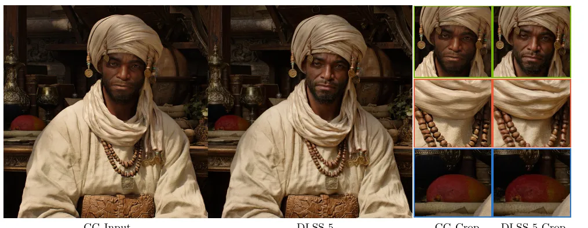
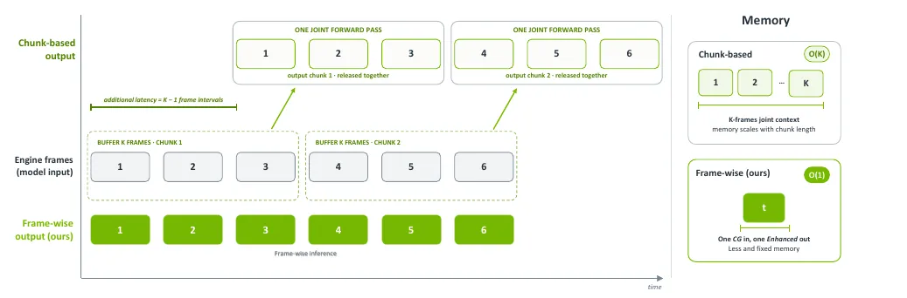
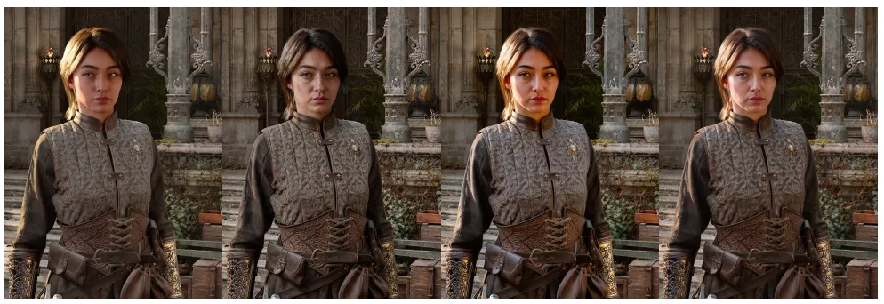
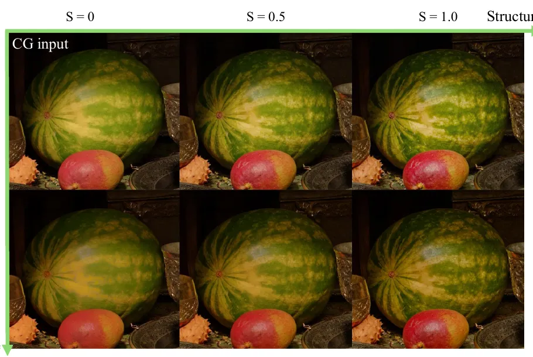
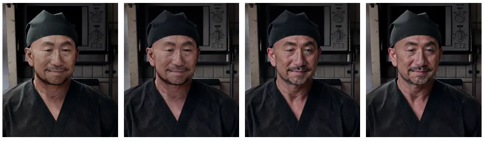
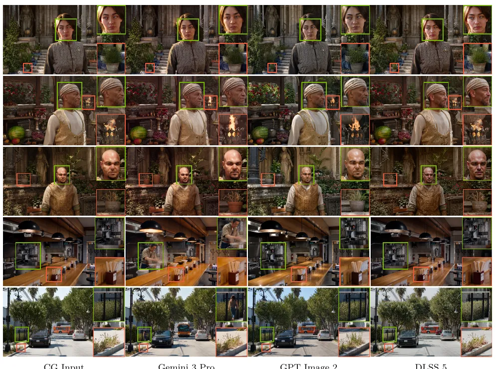
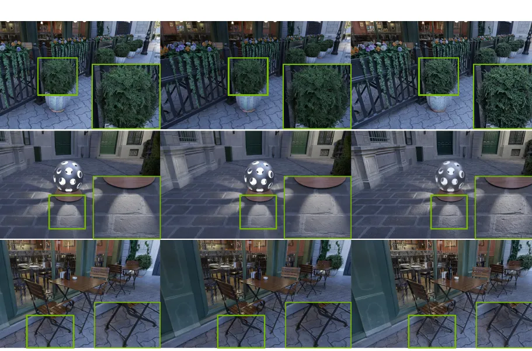
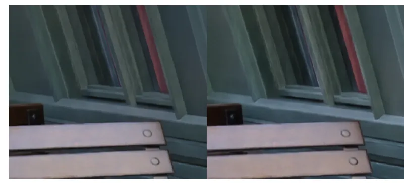
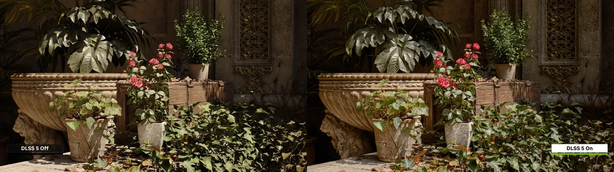
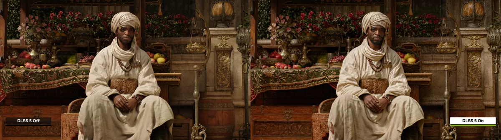

> 来源：[NVIDIA 技术报告 PDF](https://research.nvidia.com/labs/adlr/files/DLSS5_Report.pdf)（24 页，2026-09-01）· [项目页](https://research.nvidia.com/labs/adlr/DLSS5/) · [官方视频](https://www.youtube.com/watch?v=58FagrSqC4M) · [开发者博客](https://developer.nvidia.com/blog/whats-new-for-game-developers-dlss-5-with-3d-guided-neural-rendering-nvidia-ace-updates-and-new-rtx-kit-capabilities/) · [NBA 2K27 发布页](https://www.nvidia.com/en-us/geforce/news/dlss-5-3d-guided-neural-rendering/)。
> 标注：**[原文 §x]** 出自报告；**[官方视频/博客]** 出自 NVIDIA 宣传材料；**[推断]** 是我们的判断。报告标注 © NVIDIA 保留所有权利。经 Henry 同意，本页少量引用 10 张截图，每张都注明来源，仅用于研究评述。

## 一、先说结论

- **它是什么**：游戏渲染管线最后一级的「照片化」滤镜。输入当前帧渲染 RGB，输出同分辨率、更像照片的 RGB。模型是 154M 参数的 Transformer，一步、像素空间、确定性、逐帧因果，在 RTX 5090 上 4K 每帧约 8 ms，显存 731 MB [原文 §2.6, §4.3.3]。
- **真正的新意**：主要在产品化。「渲染帧→照片风格」这个任务 2021 年就有人做过（Intel，Richter 等人的 *Enhancing Photorealism Enhancement*）[推断：报告未引用]；DLSS 5 的贡献是用一步扩散加照片先验做到 4K 实时，并把 G-buffer 从推理输入改成只在训练时用的一致性监督。
- **证据缺口**：训练数据、教师、蒸馏方法、损失、时序状态怎么实现和训练，报告**一概没写**；也**没有任何时序稳定性指标**（闪烁、warp error、长时漂移都没有）。
- **评级**：重做（工程集成）× 证据不足（训练与时序部分没法核实）。单帧对齐与真实感这部分站得住。
- **对我们训练**：没有直接处方。能借鉴的是一个思路：「特权信号只做训练监督、推理时不用」。可以做一个对照，见第七节。

## 二、输入与输出

| 类别 | 内容 | 推理时用 | 训练时用 | 出处 |
|---|---|---|---|---|
| 渲染 RGB | 引擎当前帧的最终颜色，同分辨率 | ✅ 主条件 | ✅ | §2.1 |
| 运动矢量 | 引擎给出的逐像素运动 | ✅ | ✅ | Abstract, §2.1 |
| 时序状态 | 「carried temporal state」，**形式没写** | ✅ | ✅ | Abstract, §2.5 |
| 艺术控制 | 外观模型选择、structure/tone 强度、逐像素 mask、皮肤强度 | ✅ 作为学到的条件 | ✅ | §3 |
| G-buffer | albedo、法线、光照相关信号 | ❌ | ✅ 一致性监督 | §2.1 |
| 文本 prompt | 无 | ❌ | — | §2.1 |
| 输出 | 同分辨率 RGB，最高 4K；不做超分、不补帧 | — | — | §4.2 |

输出**不会改变**引擎的几何、场景状态或 G-buffer，只改「显示出来的样子」[原文 §5.4]。

## 三、原理：在保住内容的前提下，往照片分布挪

报告把问题写成一个受约束的最大化：

f(r) ≈ argmax_{x∈C(r)} p_photo(x)，并且要求 p_photo(f(r)) ≫ p_photo(r) [原文 §1.3 式 1–2]

- C(r)：保留渲染帧里几何、身份、材质、构图和明暗组织的图像集合，靠**训练时**的一致性监督来逼近，推理时没有任何硬约束 [原文 §1.2]。
- p_photo：从照片数据学到的外观先验。
- 一张渲染帧可以对应很多种合理的照片外观，这种不确定**不用随机采样来解决**，而是交给艺术控制来选 [原文 §1.3]。所以它是确定性映射，而不是采样器。

拿我们的问题来类比：这是**强条件、近似一对一**的映射，和文生视频的「一对多」性质不同 [推断]。

## 四、模型设计和背后的取舍

| 设计 | 选择 | 为什么这么选（报告给的理由） | 我们的看法 |
|---|---|---|---|
| 条件 | 直接用渲染 RGB，而不是深度、边缘、文本 | 只有 RGB 能唯一确定身份、材质、遮挡和像素级细节 [§2.1] | 合理；代价是 RGB 把内容和已有的光照烘焙混在一起，模型容易照抄 |
| 怎么破「照抄 vs 漂移」 | 训练时加 albedo、法线、光照一致性：保住这些属性，其余（细粒度着色、材质受光、环境光的整体色调）放开让模型改 [§2.1] | 「约束包络」：G-buffer 定下不能动的部分，照片先验决定可以动的部分 | 这是全文最值得记住的设计思想 [推断] |
| 空间 | 像素空间，无 VAE | VAE 往返会挪边缘、重画纹理；连输入的锯齿都要原样保留 [§2.4] | 4K 像素空间能做到 8 ms，说明网络大量依赖局部计算 [推断] |
| 步数 | 一步、确定性 | 强条件任务里多步收益不大；同样的输入序列必须得到同样的输出 [§2.3] | 和「一对多」越弱、少步越容易的经验一致 |
| 时序 | 逐帧因果，O(1) 显存，不用 chunk | chunk 要缓冲 K 帧，增加延迟，显存也随 K 增长 [§2.5, Fig.2] | 稠密 RGB 每帧都重新锚定，漂移问题天然小很多 [推断] |
| 主干 | 约 154M 参数的 Transformer，注意力沿用 DLSS 4；自动架构搜索 [§2.6]；Fig.3 只是没有坐标数值的示意散点，不是实测数据 | 速度和质量的平衡点，软件栈也成熟 | 具体结构（patch 大小、窗口注意力等）没披露 |
| 数值 | 大部分 GEMM 和 attention 用 FP8，少数敏感层 FP16，约 2× 提速 [§2.6] | Blackwell 的 TMA 和 FP8 Tensor Core | — |
| 控制 | 强度、mask 都作为**学到的条件通道**；structure 和 tone 在行为上对应高频和低频 [§3.2] | 把昂贵的多频分解融进网络里，运行时零额外开销 | 「把后处理旋钮学进模型」很值得借鉴 [推断] |
| 多风格 | 几个分别训练的外观模型（A/B/C），而不是一个连续可控的模型 [§3.1] | 单个模型覆盖整个照片分布太难 | 说明他们的可控性还是离散的 |

**训练链路**：报告披露的只有三点：①从照片数据学先验，再构造「任务专用学生」[§2.2]；②G-buffer 一致性监督 [§2.1]；③「为逐帧时序稳定而训练」[Abstract]。教师是谁、蒸馏用 DMD、对抗还是一致性模型、成对数据从哪来、怎么防曝光偏差，**全部没写**。「student」这个词暗示是从大模型蒸馏来的 [推断]。

## 五、官方案例逐个解读（按实际图像描述）

每张图都放在它要证明的论点旁边。截图都是我们自己从报告 PDF 和 NVIDIA 发布页的原图里裁出来、压缩过的。官方视频都托管在 YouTube，box 上用 yt-dlp 下载时被 YouTube 的「Sign in to confirm you're not a bot」拦下，**一个都没下载成功**；我没有用 cookie 绕过。所以视频案例只能用发布页的官方对比静帧代替。

### ① 只改外观，不改内容（Fig.1）

*图片来源：NVIDIA（DLSS 5 Report Fig.1），仅用于研究评述 · [原始出处](https://research.nvidia.com/labs/adlr/files/DLSS5_Report.pdf)*

实际看到的：一位戴头巾的男性角色。DLSS 5 版本的面部皮肤明暗和光泽更丰富，头巾和衣服的布料褶皱阴影更深，背景整体压暗、对比度更高。脸型、五官、项链和构图完全没变。三组放大裁切分别是脸、项链和前景的水果。
**能证明**：「保内容、改外观」在角色上成立。**不能证明**：整体压暗、提对比有多少是调色、多少是真正补出来的光照，单靠这张图分不出来 [推断]。

### ② 为什么放弃 chunk（Fig.2）

*图片来源：NVIDIA（DLSS 5 Report Fig.2），仅用于研究评述 · [原始出处](https://research.nvidia.com/labs/adlr/files/DLSS5_Report.pdf)*

这是一张示意图，不是实验结果。chunk 方式要先缓冲 K 帧，额外延迟是 K−1 个帧间隔，显存 O(K)；逐帧方式一帧进一帧出，显存 O(1)。它说明的是设计动机，**不是**两种方式在质量上的对比。

### ③ 外观模型是离散的几个点（Fig.5）

*图片来源：NVIDIA（DLSS 5 Report Fig.5），仅用于研究评述 · [原始出处](https://research.nvidia.com/labs/adlr/files/DLSS5_Report.pdf)*

实际看到的：同一位穿皮甲的女性角色，CG 和 Model A/B/C 四列。A 偏暖、偏柔；B 对比最强，偏冷灰；C 最亮，饱和度最高。脸和服饰结构四列一致。
**能证明**：一张渲染图可以对应多种合理的「照片」外观，靠选模型来决定；单个模型的输出是确定的。

### ④ structure 和 tone 两个旋钮（Fig.6）

*图片来源：NVIDIA（DLSS 5 Report Fig.6），仅用于研究评述 · [原始出处](https://research.nvidia.com/labs/adlr/files/DLSS5_Report.pdf)*

实际看到的：西瓜和芒果静物，2 行 × 3 列。行是 T=0 和 T=1，列是 S=0、0.5、1.0，左上角是 CG 原图。沿 S 方向，西瓜表皮纹理和芒果表面的细节、局部对比逐渐变强，但缩小后差异比较**细微**。T=1 那行的整体亮度和色调更贴近 CG 原图，T=0 那行更暗、对比更重。
**能证明**：高频（细节）和低频（整体色调）两种增强可以分开调。

### ⑤ 自动皮肤 mask（Fig.8）

*图片来源：NVIDIA（DLSS 5 Report Fig.8），仅用于研究评述 · [原始出处](https://research.nvidia.com/labs/adlr/files/DLSS5_Report.pdf)*

实际看到的：一位戴黑色头巾的亚洲中年男性。(b) 只增强非皮肤时，脸基本保持 CG 的样子；(d) 只增强皮肤时，脸部出现明显的皱纹、毛孔和高光，衣服不变；(c) 全图增强。
**能证明**：皮肤语义已经学进模型，一个全局参数就能只作用于皮肤，不需要画 mask。手动 mask（Fig.7，静物里的水壶、葡萄和瓶子）是同一个机制的逐像素版本，这里没有放图。

### ⑥ 和通用图像编辑模型比（Fig.9）

*图片来源：NVIDIA（DLSS 5 Report Fig.9），仅用于研究评述 · [原始出处](https://research.nvidia.com/labs/adlr/files/DLSS5_Report.pdf)*

实际看到的：5 行场景，依次是女性角色、头巾男子、光头男子、室内吧台、街道停车场；4 列是 CG、Gemini 3 Pro、GPT Image 2、DLSS 5。缩小到页面尺寸后，**四列的构图都很接近**，只有放大裁切里能看出编辑模型的脸、局部物体有变化。DLSS 5 那列整体更暗、对比更强。
**能证明**：和 Table 1 的对齐优势一致，但从图上看，差距远没有 LPIPS 0.06 vs 0.34 显得那么悬殊。

### ⑦ 同帧时间下比 4× 光线追踪（Fig.10）

*图片来源：NVIDIA（DLSS 5 Report Fig.10），仅用于研究评述 · [原始出处](https://research.nvidia.com/labs/adlr/files/DLSS5_Report.pdf)*

实际看到的：3 行，依次是盆栽灌木、地面上一个镂空灯球投下的光斑、室外桌椅；3 列是 CG、4× 光线追踪、DLSS 5。4× 光线追踪那列和 CG 几乎看不出区别。DLSS 5 那列灌木叶子之间的暗部更深，灯球光斑边缘和地砖纹理更清楚，椅子下的接触阴影更重。
**能证明**：多加光线主要是降噪；生成补的是渲染器没模拟出来的外观线索。差异是真实的，但幅度不大，而且只有定性图。

### ⑧ 输入差，输出也好不了（Fig.11）

*图片来源：NVIDIA（DLSS 5 Report Fig.11），仅用于研究评述 · [原始出处](https://research.nvidia.com/labs/adlr/files/DLSS5_Report.pdf)*

实际看到的：窗框加长椅的局部。CG 输入里窗框的锯齿和模糊在 DLSS 5 输出里**原样保留**，只是长椅木纹和颜色稍微更有质感。
**能证明**：它不会去「修」输入里的缺陷。这是刻意的设计，不是失败。

### ⑨ 官方对比静帧：Zorah 庭院（发布页对比 001）

*图片来源：NVIDIA（NVIDIA 发布页 Zorah comparison 001，左 Off / 右 On），仅用于研究评述 · [原始出处](https://www.nvidia.com/en-us/geforce/news/dlss-5-3d-guided-neural-rendering/)*

实际看到的：石质花坛、红花、龟背竹和地被植物。On 版的暗部更深，阳光照到的叶片高光更亮，石材的凹凸阴影更明显，整体是「更硬的直射光加更深的环境遮蔽」的感觉。植物的数量和位置完全一致。
**能证明**：植被和石材上的光照补全。这是官方挑选的展示图。

### ⑩ 官方对比静帧：Zorah 坐姿男子（发布页对比 002）

*图片来源：NVIDIA（NVIDIA 发布页 Zorah comparison 002，左 Off / 右 On），仅用于研究评述 · [原始出处](https://www.nvidia.com/en-us/geforce/news/dlss-5-3d-guided-neural-rendering/)*

实际看到的：和 Fig.1 是同一个角色的全身坐姿。On 版的白袍阴影层次更多，脸部更立体，背景的花和陶器颜色更饱和。姿态和道具不变。
**能证明**：Fig.1 的效果在全身尺度上同样成立。

### 没能核实的视频案例
官方视频（[介绍视频](https://www.youtube.com/watch?v=58FagrSqC4M)、[开发者讲解](https://www.youtube.com/watch?v=79D8SVjB3HQ)、[NBA 2K27 开发者](https://www.youtube.com/watch?v=yeMtCvxBiIM)、[发布页另一段](https://www.youtube.com/watch?v=5khwlu2qD9U)）都没能下载。之前文字稿里提到的拉面厨师、无材质的 Zorah 白模、从光栅化到路径追踪的对比，以及**任何时序闪烁表现**，本页都**没有亲眼核实**。

## 六、证据

**内容和结构对齐**（109 个场景，Table 1，越低↓或越高↑越好）

| 指标 | DLSS 5 | GPT Image 2 | Gemini 3 Pro |
|---|---|---|---|
| DINOv2 patch 距离 ↓ | **0.0364** | 0.1405 | 0.1223 |
| 图像 LPIPS ↓ | **0.0618** | 0.3386 | 0.3112 |
| Albedo SSIM ↑ | **0.888** | 0.787 | 0.804 |
| 法线平均角误差 ↓ | **12.15°** | 18.27° | 17.84° |
| 深度 Spearman ↑ | **0.933** | 0.919 | 0.898 |
| 深度边缘 Chamfer ↓ | **3.16 px** | 4.98 | 3.95 |

**真实感盲测人评**（794 次两两比较，Table 2）

| 对比对象 | 子集 | DLSS 5 胜-负-平 | 偏好率 |
|---|---|---|---|
| GPT Image 2 | 总体 | 169–164–61 | 50.63%（基本打平） |
| GPT Image 2 | 角色 | 136–95–34 | 57.74% |
| Gemini 3 Pro | 总体 | 218–122–60 | 62.00% |
| Gemini 3 Pro | 角色 | 169–77–26 | 66.91% |

路径追踪和非路径追踪两个子集上排序一致（Table 3）；但两组场景不同，报告自己也说这不能当因果证据。

**哪里站得住、哪里不行**
- 站得住：单帧对齐远好于通用编辑模型，单帧真实感和 GPT Image 2 持平，而速度快几个数量级。
- 偏有利的比较：基线是逐帧、固定 prompt 的离线**图像编辑**模型，它们本来就会重绘，对齐指标吃亏是必然的。没有和视频到视频模型、Richter 2021 类方法或 DLSS 4 RR 比 [推断]。
- 缺失：①零时序指标；②零消融（像素 vs 潜空间、一致性监督有没有用、一步 vs 多步，都只有论断）；③评测集是内部场景，可能和训练分布同源 [推断]；④结构估计器是自己训的 [§4.2]；⑤4× 光线追踪对比只有定性图。

## 七、和前作比的增量与评级

| 最接近的工作 | 关系 | DLSS 5 的增量 |
|---|---|---|
| Richter 等人 2021，*Enhancing Photorealism Enhancement*（Intel）[凭记忆，本次没重读原文] | 同一任务：渲染帧加 G-buffer → 照片风格，GAN 训练 | G-buffer 从推理输入改成只用于训练监督；GAN 换成一步扩散加大模型先验；做到 4K 8 ms 并商用 |
| DLSS 4（Transformer 版 RR/SR） | 同一骨干家族、同一部署栈 | 目标从「重建更贵的渲染参考」变成「生成渲染器给不了的外观」[§1.1] |
| Self-Forcing、CausVid、StreamDiffusion 这类流式少步视频生成 | 都是因果、少步、带状态 | DLSS 5 每帧有稠密 RGB 锚定，属于 video-to-video；逐帧而非 chunk；漂移问题的结构不同 |

**反事实**：强条件、小模型、一步就能实时，而且对齐远好于通用编辑模型，这一点专家基本能预测。4K 8 ms 和商用落地是工程上的成就，不是机制上的新发现。
**评级**：重做（工程集成）× 证据不足。产品意义很大，学术增量有限。

## 八、对我们训练（MiniMax-H3 VarLen 音视频 AR / DMD）

- **直接处方：无。** 我们的漂移来自弱条件、自己生成的历史；DLSS 5 每帧都有稠密 RGB 重新锚定，问题结构不一样，它也没公开怎么防漂移。
- **可以试的对照（低优先）**：「特权信号只做训练监督」。在 AR 或 DMD 阶段加一项辅助一致性损失，比如用 GT 光流约束相邻帧，或者用音频起始点约束运动起始。推理时完全不用这些信号。等步数对比加和不加，看后段漂移和音画同步 [推断]。
- **可以借的设计**：把引导强度或风格旋钮做成**学到的条件**，而不是固定 CFG，在 DMD 蒸馏时一并学进去，推理零开销 [推断]。
- **评测上的提醒**：只报单帧对齐和单帧人评，证明不了流式稳定。我们自己的报告要一直带长窗时序指标。

阅读记录与覆盖面

- PDF 通过 curl 下载（HTTP 200，280 MB），pdftotext 全文通读，Fig.1–11 全部渲染成图逐张看过。
- 官方视频：YouTube 要求登录验证，用 yt-dlp 下载失败，没有用 cookie 绕过；改用发布页的 4 张官方对比原图。
- Richter 2021 的描述凭已有知识，这次没有重读原文。

