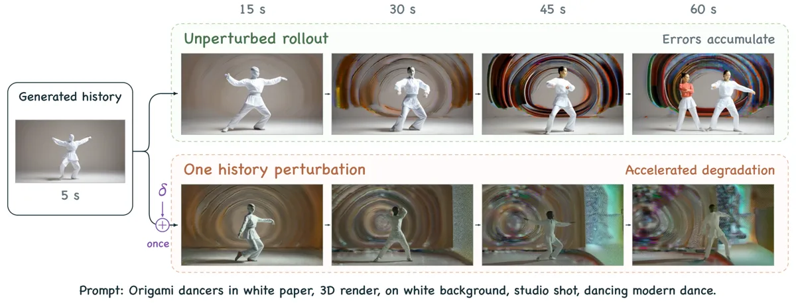
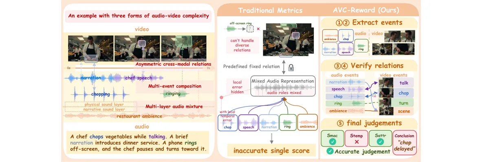

# 本周最值得读的 3 篇（10-15～10-22）

> **范围**：10-15 到 10-22 的日报、补扫、积压清理里所有评为「值得看」及以上、且有 arXiv 全文的 20 篇。只有 OpenReview 摘要的条目（CAVC、DeForcing、Mass Forcing 等）读不到全文，没法判断扎实不扎实，所以不参选。
> **怎么复核的**：Codex 只看 20 篇摘要做盲排，不知道我们原来的选择；有分歧的地方我回原文裁决。三篇的全文、AGF 代码（commit 8130b74）和 AVC-Reward 代码与公开评测数据（commit eb06598）由 Codex 抽取、复算，我对每篇至少回原文抽查 8 个数字，全部一致。**所有结论都没有在 GPU 上复跑。**
> **标注**：【论文】作者陈述或表中数字；【代码】在公开仓库核对过；【复算】我们用作者公开数据重算的结果；[推断] 是我们的判断。第五节的实验是我们的设计，不是论文结果。图片来自各论文或仓库，版权归原作者。

## 〇、一屏结论

| # | 论文 | 复核后评级 | 为什么值得你花时间读 |
|---|---|---|---|
| 1 | [Clean Forcing](https://arxiv.org/abs/2610.25634)（Northeastern·SNU·NVIDIA） | **必读**（新发现 × 站得住，限多步底座） | 它把「AR 越生越烂」变成了一个**能量出来的东西**：固定带噪输入，只换历史，看速度差多少。这个差约 95% 是系统性的，所以可以学着补回去。它在 4 步蒸馏学生上失败，而事前的测量正好能预示这个失败。对我们来说，训练之前就能估计「校正的潜在收益」有多大（作者说这是指标，不是保证）。 |
| 2 | [AGF 对抗梯度强迫](https://arxiv.org/abs/2610.14553)（浙大·阿里） | **值得看**（新机制 × 存疑），**由必读下调** | 第一个按「哪种历史误差最伤后续」来挑训练历史的方法。用 5 s 训练，同协议下 60 s 和 240 s 都赢了，人评也排第一。但消融全是单次训练，**增益究竟来自「挑方向」还是来自正则，目前没有被证明**。它适合拿来做我们 AR 历史加噪线的对照实验。 |
| 3 | [AVC-Reward](https://arxiv.org/abs/2610.22321)（浙大等） | **值得看**（新机制·评测 × 存疑），**评级定论：不是必读** | 本周唯一的音视频联合论文。它提出事件级的音视频一致性奖励模型，公开了 706 条带人评的基准。我们用它公开的数据复算发现：**它报的 DeSync SRCC 0.061，很可能是把有符号的时间偏移直接当分数用的结果**（[推断]，需要作者确认）；换成 −|偏移| 再算，DeSync 的 SRCC 是 0.271，比它自己的 0.244 还高。它真正有用的是数据和下游人评，「旧指标全失效」这个结论站不住。 |

**这周为什么是这 3 篇**：本周站得住的「原创且扎实」只有 Clean Forcing 一篇。第 2、3 名是从「值得看」这一档里挑的：大家都「存疑」，就按与 H3 训练的相关性定先后。AGF 直接对应我们的 AR 历史加噪线；AVC-Reward 是唯一的音视频联合论文，并且直接影响我们怎么评 H3。

**和上次发给你的版本相比，改了三处**：
1. AGF 从必读降为值得看。我上次说「换成高斯扰动，60 秒直接掉到 68.60，说明增益来自怎么挑扰动」，这个说法**过度解读了**，详见 3.5。
2. AVC-Reward 的评级定为值得看，不是必读。之前说的「复杂场景里 DeSync SRCC 只有 0.061」也不对：0.061 是全部 706 条样本上的数（其中 96% 是多事件），而且很可能是计算口径错了，详见 4.5。
3. 我之前建议「同步指标按单事件和复杂场景分开报」，这是**我们自己的建议**，论文里并没有单事件和复杂的分档。

**落选的几篇为什么落选**（全文都读过）：

| 论文 | Codex 盲排 | 我们的评级 | 落选原因 |
|---|---|---|---|
| [Glance Forcing](https://arxiv.org/abs/2610.20220) | **第 1** | 值得看 → **证据不足** | 核心卖点是「只用 1 条 ODE 轨迹初始化就够」。但只有默认那一条样本在 DMD 之后超过了 Causal Forcing（84.22 对 84.04）；表 4 里另外 6 条样本 DMD 后**全部低于** Causal Forcing（79.81–83.52）。没有在同配置下扫轨迹条数，正文和表格还有 4 处数字对不上。 |
| [MIST / Execution Before Memory](https://arxiv.org/abs/2610.23542) | **第 3** | 值得看 | 「执行失败被当成了记忆失败」这个发现成立，但 WRBench 已经把控制执行和记忆分层，所以增量要收窄。评委只有一个 122B 的 VLM，没有人评。 |
| [Fréchet Forcing](https://arxiv.org/abs/2610.25666) | 第 4 | 值得看 | 不需要教师的长时训练，思路有价值。但没和 Self Forcing、DMD 比，只做了 1B、240×320 的规模。 |
| [World-T3](https://arxiv.org/abs/2610.17434) | 第 5 | 值得看 | 按位姿读写的 TTT 记忆，方向可以预测。 |
| [Speculative Forcing](https://arxiv.org/abs/2610.22347) | 值得看（未进前六） | 值得看 + 部署优先 | 推理侧的提前提交机制，和 ForcingBooster 是并发工作；代码仍只有 README。 |
| [WorldPlay2](https://arxiv.org/abs/2609.35560) | 一行 | 可用资源（少步同事评值得看） | 表 8 缺「只用初始化」那一行；16 FPS 要 8 张 H20。这个分歧周五对账。 |
| [StyleStream 2.0](https://arxiv.org/abs/2610.28940) | 一行 | 摘要级暂定一行 | 只有音频（语音风格转换），方法是 MeanFlow、Self Forcing 和风格嵌入的组合。明早日报按计划给全文定级。 |

## 一、三篇对比

| | Clean Forcing | AGF | AVC-Reward |
|---|---|---|---|
| 解决什么 | AR 视频长时漂移 | 少步 AR 学生对历史误差太敏感 | 联合音视频生成该怎么评一致性 |
| 新知识类型 | **发现**：漂移造成的速度误差约 95% 是系统性的；外加一个测量工具 | **机制**：用后面块的 DMD 梯度挑出最伤后续的历史扰动 | **机制（评测协议）**：先解耦事件，再双向核验，分三级打分 |
| 专家能不能预测 | 方法骨架能想到；「约 95% 系统性」「300 段合成视频就能追平完整蒸馏」「在少步学生上反而有害」想不到 | 「对抗历史训练能提鲁棒性」能想到；用 5 s 训练撑到 4 分钟、人评第一，这个幅度想不到 | 「整段相似度会漏掉局部错误」能想到；用它的奖励替换 DeSync 后人评更好，有一定信息量 |
| 最强证据 | 同底座公平对照；跨 1.3B/14B/Causal-Forcing 三个底座复现；33 人用户研究；主动报告负结果 | 6 个方法同协议评测；12 人对 4 分钟视频做 240 次排序，平均名次 2.23；干预后的恢复测试 | 公开 706 条带人评的数据，我们复算主表 20 个数里 19 个一致；下游人评 300 次判断 |
| 最弱处 | 零真实视频版只是**追平** Self Forcing（+1.65 对 +1.08，在约 1 个标准误之内）；少步学生上失败；漂移降了但画面更容易停在原地 | 消融全是单次训练；高斯对照疑似训练失稳；去掉正则后 60 s 低于 SF | DeSync 口径疑似用错；SRCC 领先 AGAV-Rater 只有 +0.018，95% CI [−0.084, +0.108]；生成侧 RL 代码没开源 |
| 代码 / 权重 | [代码](https://github.com/wnqw/clean-forcing) Apache-2.0；权重和评测视频都公开 | [代码](https://github.com/wuli-art/Adversarial-Gradient-Forcing) Apache-2.0；[权重](https://huggingface.co/Wuli-art/Adversarial-Gradient-Forcing) | [代码](https://github.com/Tsuki0512/AVC-Reward)；[奖励模型](https://huggingface.co/Tsuki0512/AVC-Reward)；LTX-2 LoRA；基准分数表 |
| 对 H3 最直接的用法 | 只做前向的 α* 诊断，按模态分开测 | 历史加噪的 5 臂对照，外加定向扰动和高斯扰动的诊断 | 修正我们的同步指标口径；AVC-Reward 作为第二个评委，先用我们自己的人评校准 |

---

## 二、Clean Forcing：漂移是「可学的系统误差」（必读）

> 完整深读见专题页 [Clean Forcing 深读](../clean-forcing/)，下面是直击要害的版本。

### 2.1 一句话要害
自回归视频越生越烂，主要原因不是随机误差在累积，而是**历史被污染之后，模型的去噪速度出现了一个稳定、可预测的偏移**。把这个偏移测出来，用 5.9M 参数的 LoRA 学着补回去，合并进权重后推理零开销。【论文】

### 2.2 问题，以及为什么以前解决不了
- 训练时历史是干净的真视频，推理时历史是模型自己生成的有瑕疵的块。这种曝光偏差会随块数复合。
- 以前有三类做法：①给历史加噪（Diffusion Forcing 系），把误差当成均匀噪声，同底座上推理加噪 σ=0.2 反而更差（+12.05，基线是 +11.27）；②在自己的 rollout 上重训整个生成器（Self Forcing、LongLive、BAgger），有效但很贵；③冻结底座、加一个小校正器（AutoRefiner 等），但修的是采样或缓存误差，不是历史带来的误差。【论文 表1、§2】
- 缺的是：**没人直接量过「历史造成的误差」长什么样，能不能学。**

### 2.3 核心机制


*图源：Clean Forcing 论文 Fig.1 / 仓库 assets/teaser.jpg。*

```text
测量：固定带噪状态 z_t，同一个冻结模型跑两次，只换历史
  Δ = v_θ(z_t, h_clean, t) − v_θ(z_t, h_gen, t)
  换 M 个噪声种子：α* = ‖E[Δ]‖² / (‖E[Δ]‖² + Var(Δ))    # 系统性占比
训练：学生 = 底座 + LoRA，看 h_gen；老师 = 同一网络（LoRA 缩放为 0），看 h_clean
  L_CF = ‖v_{θ+LoRA}(z_t,h_gen) − v_θ(z_t,h_clean)‖² / ‖Δ‖²          # 按每个样本的缺口归一化
  闭环：DAgger 打开校正器重新 rollout，再加漂移收缩项（校正后的结果带梯度接进下一块历史）
h_clean 从哪来：同一个 1.3B 检查点用双向模式单次生成的 300 段 5 s 片段（零真实视频）
```
- 直观理解：如果漂移是随机的，换个种子 Δ 就会变方向，平均下来接近零。实测三个多步底座 α* 都在 0.89–0.99，说明 Δ 几乎只由「历史坏在哪」决定，所以一个确定性的小网络能学会它。【论文 Fig.7】

### 2.4 最接近的前作和增量
| 前作 | 它做什么 | Clean Forcing 多了什么 |
|---|---|---|
| [Self Forcing](https://arxiv.org/abs/2506.08009) | 在自生成 rollout 上用 DMD 做分布级目标，更新整个生成器 | 不改生成器，只学「历史造成的那部分」误差；不需要 14B 教师 |
| [DFoT 历史引导](https://arxiv.org/abs/2502.06764) | 推理时用「有历史 / 无历史」的速度差做引导 | 结构最像，但它只在推理时外推，同底座上更差（+20.55） |
| BAgger / DAgger | 收集学习者自己走到的状态，再重训 | 闭环阶段直接借用了这个思路；增量在于老师是「同一模型看干净历史」 |

### 2.5 反事实：专家能预测什么
- **能预测**：用「看干净历史时的自己」当老师，属于特权老师的老思路；DFoT 已经在用换历史的速度差；DAgger 是教科书做法。
- **预测不到**：①约 95% 的误差是系统性的，而且在三个底座上都成立；②只用 300 段合成片段和 5.9M 参数，就能把一个重度漂移的底座拉到和完整 DMD 蒸馏打平；③容量越大反而越差（全参微调只降 23% 的漂移，LoRA 降 73%）；④在少步蒸馏学生上**有害**，而且事前的 α* 能预示这一点。【论文 表9、附录 E】

### 2.6 证据：最强与最弱
- **最强**：50 秒、128 条提示，Δ-drift 从 +11.27±0.81 降到 +1.65±0.35（零真实视频），加 40 段真实片段后是 −0.16±0.12【论文 表1】。同底座公平对照，14B 和 Causal-Forcing 底座都能复现，还有 33 人、858 次判断的用户研究【附录 J】，负结果也主动报告并公开了权重。
- **最弱**：①零真实版和 Self Forcing 是**打平**（+1.65 对 +1.08，差 0.57，合并标准误约 0.52），绝对画质 MUSIQ 也更低（66.9 对 69.3）。②移植到 4 步 Self Forcing 上，MUSIQ 从 69.3 掉到 47.5，Δ 从 +1.08 涨到 +8.3【附录 E】。③漂移降了，但画面更容易停在开头（anchoring 0.795），块边界亮度跳变和 flicker 是全表最差。

### 2.7 局限与疑点
用来对比的底座只做了 4K 步因果适配，本身漂移余量就大；主指标是自动指标，用户研究只测了加真实视频的版本；14B 的检查点选择很敏感。少步上失败的原因作者没有拆开，我们的推断是：「干净参考」是 1.3B 底座生成的，它可能还不如 SF 学生自己干净（详见专题页第六节）。

---

## 三、AGF：专挑「最伤后续」的历史来训练（值得看，由必读下调）

### 3.1 一句话要害
AGF 在模型自己生成的历史里，主动找出会让后面生成变差最多的小误差，再训练模型扛住它。现有证据支持的是「**定向扰动 + 首步一致性正则 + 先正则后关闭的训练日程**」这一整套组合，**还没有干净地证明「挑方向」本身带来了增益**。【论文 §3；表2】

### 3.2 问题，以及为什么以前解决不了
- Self Forcing 让训练看到自生成的历史，缓解了训练和推理之间历史分布不一致的问题，但没有专门找出「会被后面放大」的那类误差。SGF 通过重算历史表示，让梯度也能更新历史编码，同样不挑危险历史。【§2.1】
- GameNGen 式的随机加噪、Helios 式的预设帧破坏，增加了坏历史的种类，但**不看每种破坏对后续伤害多大**。作者原话：现有方法都没有「显式评估单个历史扰动如何影响后续生成，并据此挑选训练历史」。【§2.2】
- 作者给的现象：在 Self Forcing 上，只对 5 s 的历史扰动一次，背景伪影就提前出现、越来越重。【Fig.2】



*图源：AGF 论文 Fig.2（arXiv HTML 版 history_gap.png）。注意：这张图**没有**同幅度高斯扰动的对照，扰动的构造和幅度原文也没写。*

### 3.3 核心机制
直观地说：先让模型自己生成一段历史，然后问「把历史往哪个方向轻推一下，会让后面块的预测离教师分布最远？」，再拿这种最坏的历史来训练。

1. 无梯度 rollout（7 块，每块 3 个 latent 帧，约 5 s），随机选一个历史块 j。
2. 冻结生成器，用**后续块的 DMD 梯度**反传到块 j 的 latent，一次 VJP 得到 u。
3. 沿块内帧维平均后归一化：δ\* = ε·ũ / RMS(ũ)，ε = 0.05（latent RMS）。只走一步，不随机初始化，块内各帧用同一个扰动。【附录 A.4；表4】
4. 干净历史和对抗历史各占 0.5 权重算 DMD 损失；对抗分支的损失只算块 j 之后。
5. 前 200 步加**首步一致性正则**：在同一个初始噪声下，对抗分支第一步的速度要对齐干净分支（干净分支 detach），用来约束场景布局；正则权重按梯度 RMS 动态调到 DMD 梯度的约 5%，第 201–400 步关掉。【§3.3；附录 B.4】

```text
rollout（无梯度）→ 记录历史 H、t* 处的输入、初始噪声
选 j；δ←0；冻结 θ，并行重算 → g = DMD 梯度（只取 >j 的块）
u = J_jᵀ g；ũ = 沿帧平均；δ* = sg(0.05·ũ/RMS(ũ))
L = 0.5·ℓ_DM(clean, 全部块) + 0.5·ℓ_DM(H+δ*, 只算 >j) [+ λ_s·MSE(v_adv首步, sg(v_clean首步))]
更新 θ（梯度经过重算的历史 KV）；两路输出进 replay，供 fake score 训练（5:1）
```

**关键区别**：AGF 选扰动的准则是「沿 DMD 梯度让后续**分布失配**最大」，而不是「让后续**变化**最大」。附录 A.2 用一个旋转反例说明，后续对历史高度敏感，不等于分布错了。【§3.2】

### 3.4 最接近的前作和增量
| 方法 | 训练时的历史 | 扰动怎么选 | 和 AGF 的差别 |
|---|---|---|---|
| Self Forcing | 自生成 rollout | 不主动扰动 | AGF 在它之上加了「挑最坏的历史」 |
| SGF | 无梯度 rollout，再可微地重算 | 不主动扰动 | AGF 复用了这套「rollout + 并行重算」的训练骨架（代码同源），但不是从 SGF 检查点起训 |
| GameNGen / Helios 式历史加噪 | 加噪或预设破坏 | 随机 / 规则 | AGF 按下游 DMD 损伤挑方向，幅度很小（RMS 0.05），只扰一块 |
| FGSM 式对抗训练 | 对输入加扰动 | 损失梯度的符号方向 | AGF 改成用 L2/RMS 归一化，信号来自后续块的 DMD，扰动加在历史 latent 上 |

### 3.5 反事实，以及我们对上次判断的更正
- **能预测**：如果问题确实是历史误差被放大，那么针对高伤害方向做训练应该能提鲁棒性，收益主要出现在长时续写。Codex 只看摘要盲评时，把它判为「重做（可预测）」。
- **预测不到**：只用 5 s rollout、80 次生成器更新训练，在 4 分钟视频上人评排第一。
- **更正**：上次我说「换成高斯扰动，60 秒直接掉到 68.60，说明增益来自怎么挑扰动」。核对原文后，这个推论站不住：
  - 高斯变体带正则、训练步数相同【附录 H】，却掉到 **68.60**，远低于**什么扰动都不加**的 Self Forcing（79.56）。[推断] 同 RMS 0.05 的小高斯噪声比不扰动还差 11 分，可能是这个变体的单次训练失稳；但没有日志或重复实验，现有材料区分不了「失稳」和「方法本身就差」。无论哪种，都不能当作「挑方向值 9.71 分」的干净证据。
  - 去掉正则后，AGF 在 60 s 只有 **77.96，低于 SF 的 79.56**。也就是说，对抗历史单独并没有稳定胜过 SF。
  - 所以增益是对抗历史和正则的**组合**带来的，单独哪一块都没有站得住的证据。

### 3.6 证据：最强与最弱
**最强**
1. **同协议主表**：6 个方法用同一套生成和评测流程，60 s Total：AGF 81.47，SF 79.56，Causal Forcing 79.83，LongLive 79.81，SGF 79.67（SGF 是作者用官方设置复现的）。【表1】
2. **人评**：12 人、240 次排序任务、120 条提示，每题对 6 个 4 分钟视频排序。AGF 平均名次 2.23，LongLive 2.85，SF 4.43。【§4.4；附录 I】
3. **干预后的恢复**：在 30–60 s 往历史里注入模糊或定向误差，相对每条视频最初 20 s，AGF 在 90–240 s 的 Q5 平均只变化 −0.17 / −0.13 个点，5 个基线是 −1.0 到 −2.3 个点。这个变化里既有干预的影响，也有自然漂移。【附录 G.2；Fig.15】

**最弱**
1. 消融全部是**单次训练**、每条提示只生成一个视频，作者自己也说不估计种子和检查点带来的方差。【附录 D.3、H】
2. 上面说的高斯对照疑似训练崩溃；而高斯消融的代码分支**没有公开**，没法核对。【代码 docs/training.md:86】
3. 增量不大：相对 SGF，240 s Q5 只多 +0.75（84.82 对 84.07）；5 s Total 82.03，低于 SF 的 82.21。论文没报推理 FPS。【表1】

### 3.7 局限与疑点
- 选方向是在固定的已记录历史上做并行重算，是一个局部的一阶近似，不等于整条长链上的最坏误差。
- Q5 不含动态度，局部 Q5 高也不能证明主体一直和开头对得上。
- 训练成本只看总数 GPU·h 是 364.4，比 SF 的 431.6 少，但这是因为只做了 80 次生成器更新。按我们的算力拆解，**每个生成器步大约是 SGF 的 2.0–2.3 倍**。【表5；agf-deep 代码拆解】
- 历史用的是 t\* 处的 x0 预测，不是最终干净块（论文附录 B.2 有说明）；代码里每张卡各自抽 t\*，这一点论文没交代。【代码 pipeline/self_gradient_forcing_training.py:90-100, 239-242】

---

## 四、AVC-Reward：事件级的音视频一致性奖励（值得看）

### 4.1 一句话要害
它把音视频一致性的评估改成「**先把音频事件和视频事件各自拆出来，再双向核对，最后按整体叙事、事件时间同步、细粒度属性三级打分**」，并蒸馏成一个 Qwen3-Omni-Thinking 奖励模型。真正可用的是**公开的带人评基准**和**用它替换 DeSync 当 RL 奖励后的人评结果**；「旧指标在复杂场景几乎失效」这个结论，我们复算后认为站不住。



*图源：AVC-Reward 仓库 fig/main-fig-cropped.png。*

### 4.2 问题，以及为什么以前解决不了
- 联合音视频生成的场景越来越复杂：同时有多个事件、多层音频混在一起（旁白、背景音乐、物理声音），跨模态关系也不对称（比如画外音）。【§1】
- 旧指标的粒度各不相同（有整段片段级的，有时间窗口级的，也有帧级的），但大都作用在混合音轨上，也不区分事件和音频角色：DeSync（Synchformer）在时间窗口上预测偏移，ImageBind 算整体语义相似度，AV-Align 把音频起始点和视觉运动峰值对齐。旁白和画外音会被误罚，局部错误会被整体相似度掩盖。【§1、表1】

### 4.3 核心机制
```text
H_A = 独立分析音频(时间段, 类别, 物理/叙事角色, 声学属性)
H_V = 独立分析视频(时间段, 发声动作, 位置/运动；自然无声的动作只作为上下文)
R = 音频→视频核验 ∪ 视频→音频核验     # 无可见声源 ≠ 判错，允许合理画外音
S_mac  = 整体叙事是否协调
S_temp = 事件该不该有、有没有、起止和节奏是否对得上
S_attr = 材质、音色、响度、口型等属性是否一致
S_AVC  = (S_mac + S_temp + S_attr) / 3      # 等权平均【式3；附录 A.4】
```
- 训练：先用 Gemini 2.5 Pro / Qwen3-VL-Max 分阶段生成推理链，SFT 用 8k 条（1 个 epoch）；再用 10k 条 rollout 做 GRPO（1,700 步），奖励由结构分和「与人评校准后的分数接近程度」组成。【附录 B–C】
- 推理：通过 vLLM 服务调用，每次最多生成 4096 个 token，温度 0。代码里没写死视频采样帧数，模型规模也没核实到。【代码 reward_model/code/rm_reward_client.py, start_reward_vllm.sh】

### 4.4 最接近的前作和增量
| 前作 | 怎么评 | AVC-Reward 多了什么 |
|---|---|---|
| AGAV-Rater | 从真实 V2A 输出里学人类偏好，对整段片段打分 | 拆成事件，区分音频的角色，双向核验 |
| DeSync / Synchformer | 对混合音轨预测一个时间偏移 | 按事件逐个判断时间对应关系 |
| 零样本 MLLM 评委（Gemini、Qwen3-Omni） | 直接问模型 | 用结构化推理做 SFT，再按人评做 GRPO；基线 Qwen3-Omni-Thinking 的 SRCC 是 0.154，训练后 0.244 |

### 4.5 我们的复算：DeSync 的 0.061 疑似口径有问题
作者公开了 706 条样本的人评和各评委分数（`benchmark/data/*.csv`）。用作者自己的打分脚本复算：
- **主表能复现**：DeSync、AV-Align、AGAV-Rater、Qwen3-Omni-Thinking、AVC-Reward 这 5 个评委的 20 个数，19 个按三位小数完全一致；AVC-Reward 的 PLCC 算出来是 0.4935，论文写的是 0.494。【复算】
- **DeSync 这一列看起来是有符号的时间偏移**：取值从 −2.0 到 +2.0，步长 0.2，其中 36.5% 是负值；论文附录的案例也写着「DeSync: −1.6」。官方打分脚本**直接拿原值和人评算相关**，没有取绝对值。如果它确实是有符号偏移，+2 s 和 −2 s 都是严重不同步，按原值排序就没有意义。表 3 的生成实验用的是 DeSync↓ 的小正数，作者没写两处分别怎么换算。【复算；代码 benchmark_eval.py；论文 表3、附录 E】[推断：「有符号」是根据数据分布判断的，需要作者确认]
- 换成 −|偏移|（偏移越小分越高）之后，再用官方脚本算：

| 评委 | Pairwise | ∆-Pairwise@0.2 | PLCC（5PL） | SRCC |
|---|---|---|---|---|
| DeSync（论文口径：有符号原值） | 0.521 | 0.580 | 0.280 | **0.061** |
| **DeSync（−\|偏移\|）** | **0.595** | 0.687 | 0.284 | **0.271** |
| AGAV-Rater | 0.580 | 0.646 | 0.261 | 0.226 |
| AVC-Reward | 0.586 | **0.728** | **0.494** | 0.244 |
| 人评上限 | 0.756 | 0.920 | 0.781 | 0.497 |

- **不确定性**：2000 次 bootstrap 下，AVC-Reward 减 AGAV-Rater 的 SRCC 差是 +0.018，95% CI [−0.084, +0.108]；减 −|DeSync| 是 −0.027，CI [−0.122, +0.069]。**SRCC 上，这几个评委统计上分不出高下。** AVC-Reward 只在 ∆-Pairwise 和拟合后的 PLCC 上点估计更高，这两项没做 bootstrap，稳不稳定不知道。【复算】
- 在 119 条受控负例上（按 id 推断，包括音频平移 ±2 s、删事件、冻结画面等），−|DeSync| 的 SRCC 是 0.437，AVC-Reward 是 0.402。【复算；id 到来源的映射是推断的】
- **结论**：「DeSync 和人评几乎不相关」不成立。真正的事实是：**所有自动评委（包括 AVC-Reward）和人评的 SRCC 最高也只有约 0.27，而人和人之间的一致性上限只有约 0.50。**

### 4.6 下游：用它当 RL 奖励
- 在 OmniNFT 框架里，把 LTX-2 的 DeSync 奖励换成 AVC-Reward，训练分两段：600 步加 275 步，期间还调了学习率和奖励权重，所以**不是纯粹只换奖励**。【附录 C.3】
- 自动指标上，AVC-Score、IB-AV、AV-Align、Javis 和 AVH 都比 OmniNFT 好；但 CAVP 在三个基准上都略低，DeSync 在三个里有两个略差（比如 AV-Phys 上 0.081 对 0.073）；文本对齐也略降（AV-Phys 上 CLIP 从 OmniNFT 的 0.282 降到 0.272）。【表3】
- 人评：100 条提示、10 名标注员、300 次判断。一致性这一项上，AVC-Reward 相对 OmniNFT 的胜率是 63.5–73.1%。标注员之间的 Jaccard 一致率只有 42–44%。【表19–20】
- 没有做专门的 reward hacking 检查；生成侧的 RL 训练代码也没开源，仓库只有 LoRA 的合并和推理。【代码 README TODO】

### 4.7 反事实、证据强弱与局限
- **能预测**：「整段相似度会漏掉局部错误」「画外音会被误罚」，熟悉这个领域的人都能想到。
- **有信息量的**：①用 DeSync 当奖励，会把 DeSync 刷到很低（0.07 左右），但人评仍然更偏好用事件级奖励训出来的模型；②三个维度大体能对上：把某个预测维度打乱后，对应那一类人工问题标签的分类 AUC 掉得最多，但其他维度也受一点影响。【表18】
- **最强**：基准、评分和打分脚本都公开，能独立复算；下游有人评。
- **最弱**：DeSync 口径（见 4.5）；没有逐个组件的消融，比如去掉事件拆分或去掉某个核验方向；训练和评测的生成器来源有重叠（Ovi、HunyuanVideo-Foley、内部 A2V 模型），没有按生成器留出来测；人评上限 0.497 没法用公开的 CSV 复算，因为里面没有逐人评分。

---

## 五、对我们训练的合并行动清单（MiniMax-H3 VarLen 联合音视频）

这三篇在 H3 上能拼成一条链：**先测「漂移修不修得了」，再决定训练里怎么造历史，评测口径同时修好**。实验都是我们的设计。

| 优先级 | 实验 | 来源 | 做法 | 成本 | 什么结果会改变决策 |
|---|---|---|---|---|---|
| **P0** | E0 漂移可学性诊断 | Clean Forcing | 在 AR 多步检查点和 DMD 少步学生上分别做：固定 z_t，换历史，多个种子，**视频和音频分开**算 α* 和相对缺口。按各模态自己的 σ 分桶（视频 shift 12，音频 shift 3）。再加一个 2×2 实验：视频历史和音频历史各自取干净或生成 | 约 6K 次前向，不训练 | AR 检查点上 α*≳0.9 且缺口大，就值得加校正器，放在蒸馏之前；少步学生 α* 低，就别往部署模型上加 |
| **P0** | D1 定向扰动和高斯扰动的诊断 | AGF | 用现有检查点，在同一套框架里各扰一次历史块：同 RMS 的 DMD 梯度方向，对比高斯方向，看长窗口漂移和 DeSync 随时间的变化。可以只扰音频或只扰视频，看漂移会不会跨模态传染 | 每个样本 1 次 VJP 加 rollout，不训练 | 如果定向扰动并不比高斯更伤，说明我们的模型没有 AGF 说的那种缺口，就不用上 AGF |
| **P0** | M1 修正同步指标口径 | AVC-Reward 复算 | 自查我们的评测脚本里 DeSync / Synchformer 用的是有符号偏移还是 \|偏移\|；统一报 \|偏移\|，并按时间段分开报（前 20% 和末段） | 半天 | 如果之前用的是有符号原值，历史上的同步结论要重算 |
| P1 | M2 第二评委加人评校准 | AVC-Reward | 用公开权重在约 100 条 H3 样本上打分，同时做一小轮三人人评；对比 \|DeSync\|、AV-Align、AVC-Reward 和人评的 SRCC | 推理开销（每条最多 4096 token）加约 300 次人评 | 只有在我们自己的数据上明显优于 \|DeSync\| 时，才考虑把它用作 RL 奖励 |
| P1 | T1 AGF 五臂对照 | AGF | 在 AR 历史加噪线上，等步数、同初始化：①底座；②加高斯（只扰 1 块，同 RMS）；③加 AGF 对抗历史（不带正则）；④只加首步正则；⑤完整 AGF。至少 2 个种子，看长窗口后段漂移和开头质量 | 每个生成器步约是 SGF 的 2.0–2.3 倍，5 臂 × 2 种子 | ④对①、③对②这两组对比，能回答增益来自正则还是来自方向 |
| P2 | T2 Clean Forcing 校正器 | Clean Forcing | 只有 E0 结果为正时才做：rank-16 LoRA 一步校正，然后 DAgger 加收缩；和「训练时历史加噪」以及两者叠加做对照。同时报 anchoring 和场景推进，防止漂移降低只是因为画面不动了 | 中等（论文 1.3B 约 1 个 GPU-day） | 漂移降了但 anchoring 明显升高，说明场景推进可能受损，要结合运动量和人工检查判断是不是「不动」带来的假改善 |
| P2 | R1 AVC-Reward 当 RL 奖励 | AVC-Reward | 只在 M2 通过之后做；加上 reward hacking 检查（人评分数随训练步数的变化曲线） | 高 | — |

**一句话**：先花几千次前向，回答两个问题：「我们的漂移是不是可学的系统误差」（E0），以及「定向的历史误差是不是比随机误差更伤」（D1）。同时把 DeSync 的口径修好（M1）。三件事都不需要训练，然后再决定要不要上 AGF 或校正器。

---

## 六、复核记录与未核实项

<details markdown="1"><summary>Codex 盲排结果与分歧裁决</summary>

- **Codex 盲排**（只看 20 篇摘要，不知道我们原来的选择）：①Glance Forcing ②Clean Forcing ③MIST；④Fréchet ⑤World-T3 ⑥AGF。AVC-Reward 评值得看，没进前三，理由是「人类对齐和 RL 收益在摘要里没有数字」。
- **一致的地方**：Clean Forcing 进前三。
- **Glance**：我们读了全文，并让 Codex 专门核对。结果见第〇节「落选」表，判为证据不足，不进前三。
- **MIST**：维持值得看。10-21 补读 WRBench 后，增量已经收窄；而且只有 VLM 评委。
- **AGF**：Codex 判为「可预测的重做」，我们认为部分成立，所以从必读降为值得看。它仍然留在前三，原因有三：主表和人评站得住，对我们的历史加噪线最直接，而且「值得看」这一档里的其他候选证据都不比它强。
- **AVC-Reward**：Codex 担心的「没有数字」是摘要层面的问题，全文其实有。但我们复算后，又找到了一个更严重的问题（DeSync 口径），所以评级定在值得看。留在前三靠的是「音视频联合优先」这条平局裁决规则。

</details>

<details markdown="1"><summary>抽查过的数字（全部和原文一致）</summary>

- **AGF**：81.47、79.56、68.60、77.96、84.07、2.23、364.4、−0.17 pp（表1、表2、§4.4、表5、附录 G.2）。
- **Clean Forcing**：+11.27、+1.65、−0.16、+1.08、α* 0.89–0.99、858 次判断、MUSIQ 69.3→47.5、5.9M（表1、§4、附录 E/J）。
- **AVC-Reward**：0.061、0.497、0.244、0.494、0.586 / 0.580、706、0.728（表2），以及 0.073 / 0.081（表3）、10 名标注员（附录 F）。其中 0.494 复算出来是 0.4935。

</details>

<details markdown="1"><summary>未核实 / 不确定</summary>

- 三篇都**没有在 GPU 上复跑**。
- AGF 的高斯消融分支没有公开，所以「训练崩了」只是推断。
- AVC-Reward：DeSync 列「有符号」是从数据分布和论文案例推断的，作者没写具体怎么换算；id 到来源的映射也是推断的；人评上限 0.497 没法用公开数据复算；奖励模型的参数规模没核实；生成侧 RL 代码没开源。
- Clean Forcing：少步学生上为什么失败，是我们的推断，作者自己说没有把机制隔离出来。
- 落选的 StyleStream 2.0 只看了摘要。

</details>
